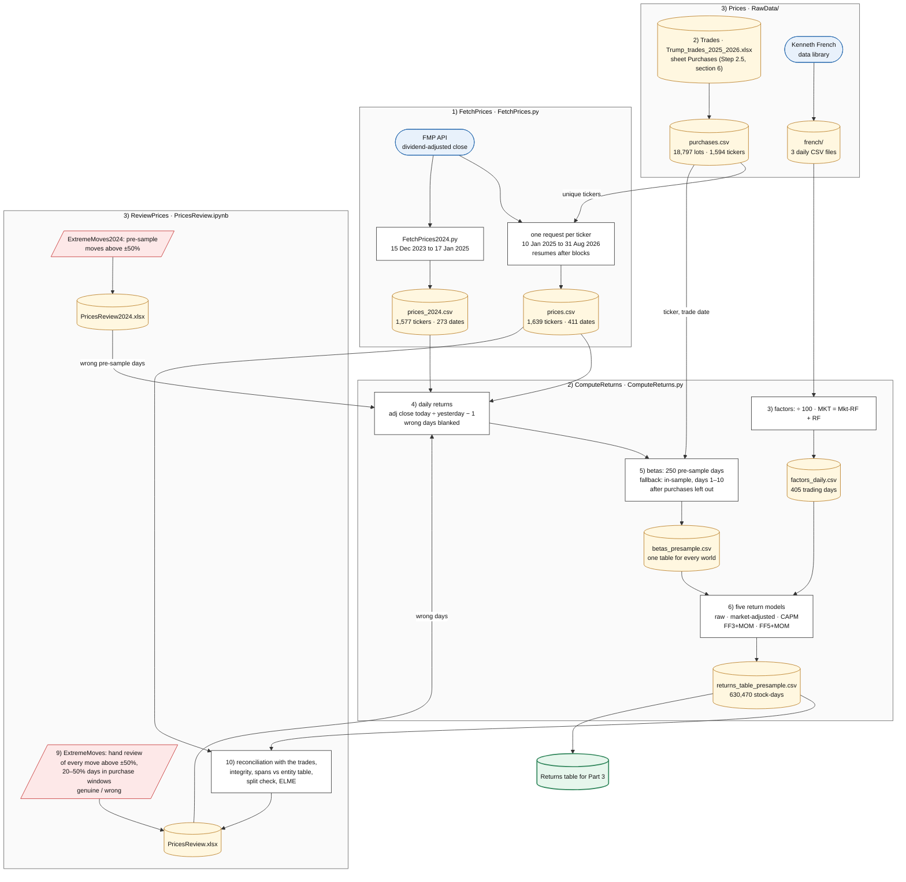
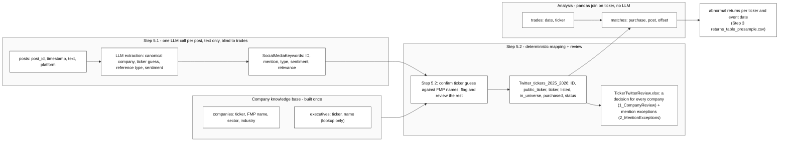

# Methodology and Data Plan
The entire blueprint and datahandling for the master thesis

## Research Question
***Does President Trump's disclosed stock trading precede his positive posts about the same companies more often than chance would predict, and if so, are those trades better timed than luck?***

Three parts, as in the kokebok: Part 1 (Step 7) asks whether he posts more about a company after buying it; Part 2 (Step 8) whether purchases are followed by positive posts (the main count), and by any post, more often than the shifted worlds give; Part 3 (Step 9) whether those purchases earned more than the same purchases on shifted dates. The thesis does not test whether posts move prices and makes no claim about intent.

## How this plan, the kokebok and the folders fit together
The kokebok says what each step measures and why; this plan says how the step was run; the folder of the same number holds its files. Step N is kokebok step N and folder N, with one exception: Exhibits is Step 11 here (folder `11) Exhibits/`) and kokebok step 12, and reading the result is Step 12 here and kokebok step 11. Inside a step, N.k is section k of the step's notebook, or its k-th sub-folder or script.

| Step | Kokebok step | Folder | Main file | Output |
|---|---|---|---|---|
| 1 | Collect posts | `1) SocialMedia/` | `Fetch/`, `CleanRawData.py`, `Merge.py` | `SocialMediaPosts.json` |
| 2 | Collect purchases | `2) Trades/` | `TradesCleaning.ipynb` | `Trump_trades_2025_2026.xlsx` (sheets `Trades`, `Purchases`, `PurchasesMerged`) |
| 3 | Prices and market-adjusted daily returns | `3) Prices/` | `1) FetchPrices/`, `2) ComputeReturns/`, `3) ReviewPrices/` | `returns_table_presample.csv`, `betas_presample.csv` |
| 4 | Build the company database | `4) CompanyDB/` | `BuildCompanyDB.py`, `BuildEntities.py` | `company.db` |
| 5 | Label posts | `5) MapTweetCompany/` | `1) LabelTweets/`, `2) MapToTickers/`, `3) LabelAccuracy/` | `Twitter_tickers_2025_2026.xlsx` |
| 6 | Define the calendar shifts | `6) CalendarShifts/` | `CalendarShifts.py` | `worlds.csv` |
| 7 | Part 1: talk | `7) Part1Talk/` | `RunPart1.py` (`1) BuildPanel/`, `2) Estimate/`, `3) Inference/`) | `results.csv`, `inference.csv` |
| 8 | Part 2: timing | `8) Part2Timing/` | `RunPart2.py` (`1) Hits/`, `2) Inference/`) | `purchase_hits.csv`, `inference.csv` |
| 9 | Part 3: returns | `9) Part3Returns/` | `RunPart3.py` (`1) Returns/`, `2) Inference/`) | `purchase_returns.csv`, `inference.csv` |
| 10 | Checks | `10) Checks/` | `Checks.py` | `robustness.csv`, `ChecksReport.txt` |
| 11 | Exhibits | `11) Exhibits/` | `Exhibits.py` | `tables/`, `figures/` |
| 12 | Read the result, state the limits | writing | | |
| 13 | Write-up | writing | | |

Step 2.5 corrects tickers found wrong by a first run of Step 3; on a rerun the order is Step 2, then Step 3.

## Decisions and limitations
Choices made while building the data, and what each one means for the analysis. Trade-specific choices are under *Notes on Trading Extraction*; the step that produced each choice is in brackets.

- **Sample window:** posts from 2025-01-20 (inauguration) to 2026-08-31; purchases up to 2026-07-31 so every purchase has a complete ten-day window. [Step 1.3.a, 5.2]

- **Text only.** Image/video descriptions does not apply. We only use the text that is posted. Posts without text (photo/video-only posts, bare links) are excluded: 5,661 rows, 5,178 of them @realDonaldTrump on TruthSocial. A company that appears only in a picture or video is invisible to the analysis. [Step 1.3.d, 5.1]
- **Labels are produced blind to the trades.** Step 5.1 reads only the post text; the trade tables are first joined in the analysis. [Step 5.1]
- **No keyword or alias dictionary.** The LLM names the listed parent and guesses the ticker; Step 5.2 confirms it against the FMP names of the traded tickers. SEC former names and LLM keywords were dropped on 2026-11-03. [Step 4.1.2, 5.2]
- **Content filter at Microsoft's default level** (a relaxed custom guardrail was tried and blocked more, see Step 5.1). Posts Azure blocks are kept with `llm_status = content_filter`, counted and listed; the text is never edited to pass the filter. [Step 5.1, 5.3.4]
- **Sentiment is a score** from −1 to 1; Praised means ≥ 0.5 and Roasted ≤ −0.5, with ±0.3 and ±0.7 as a sensitivity check. The cut-offs were fixed on 2026-11-07 in `8) Part2Timing/0) Decisions.md`, before any hit was counted. [Step 5.1, 8.1]
- **Timestamps are stored in UTC** (`created_at`, `YYYY-MM-DDTHH:MM:SSZ`, in every post file and in `Twitter_tickers_2025_2026.xlsx`); the HuggingFace dataset is UTC too (confirmed 2026-11-09). The post day is assigned in US Eastern time (`America/New_York`, setting `POST_TZ`) wherever posts meet trade dates (Steps 7 and 8), so nothing is converted in the stored data and daylight saving is handled by the time zone, not by a fixed offset. [Step 1.3, 7.1, 8.1]
- **The 21 unpriceable purchases** (BRKL, PINC, NVRI, RNAM, WOLF) stay in Parts 1 and 2, which need no prices, and are left out of Part 3; 0.1 percent of purchases. [Step 2.6, 8.1, 9.1]
- **Links are removed from the text** and kept in the `links` field, so a post that was only a link counts as empty. [Step 1.3.b]
- **One post is one event.** Cross-posts (identical text within 24 h, 2,096 rows) and retweets of one of the three sampled accounts whose original post is in the dataset (3,442 rows) are collapsed to the earliest copy. @POTUS therefore keeps only 106 own posts: the account is almost entirely retweets of @WhiteHouse. [Step 1.4]
- **Reposts of accounts outside the sample count as posts of the reposting account**, with the full original text (the API truncates retweets at 140 characters; the embedded original is used instead). Quotes carry the quoted text as `QT @user: …`; X Articles are reduced to their title; quotes of media-only posts carry only the comment. [Step 1.3.c]
- **Replies are excluded on X** (`-filter:replies`). TruthSocial has no reply filter; the 54 @WhiteHouse replies in the sample are kept. [Step 1.1, 1.2.a]
- **@realDonaldTrump TruthSocial comes from a third-party dataset**, since the API blocks scripted access to that account: timestamps are rounded to the minute and ReTruths are missing (they appear only as bare links and are dropped). [Step 1.1.b]
- **@WhiteHouse TruthSocial starts 2025-03-18**, the account's first post. [Step 1.1]
- **twitterapi.io gap:** 2026-04-10 → 2026-04-12 returns no tweets for any of the three accounts; treated as a known hole. [Step 1.2.d]
- **Betas from a pre-sample year.** CAPM and factor betas are estimated on the 250 trading days ending 2025-01-17 and held in one table used unchanged in the real world and every shifted world; stocks without 60 valid pre-sample days use their in-sample estimate. The intercept is estimated but left out of the prediction. [Step 3.2.3, 3.2.4]
- **642 days between 20 and 50 percent outside any purchase window are not reviewed.** They enter no pre-sample beta and no real-world purchase window; they affect only the in-sample betas of the fallback tickers (17 days) and can fall inside a shifted world's windows. [Step 3.3.1]
- **Part 3 keeps the same purchases in every world** (2026-11-09). Only tickers with a market-adjusted return on every trading day from 2025-01-21 to 2026-08-28 take part in the return test: 1,501 of 1,594 tickers, 17,235 of 17,724 purchases; the 489 left out are 1.2 percent of the amount. This also settles the purchase windows cut by a takeover: their tickers have shorter series and are left out of Part 3. The days marked wrong in the price review (10) count as a zero market-adjusted return. [Step 9.1]
- **Smallest shift 30 days** (2026-11-09). Shifts under 30 days either way are left out (kokebok): a purchase moved by a few days stays inside its own ten-trading-day window, so such a world partly repeats the real one. 500 worlds: the real one and every shift from 30 to 528 days (499 worlds, shifts 30 to 527, until L = 558 on 2026-11-10); the first runs used every shift from 1 day (557 worlds). [Step 6]
- **Midpoint amounts only** (2026-11-09). Every dollar figure uses the midpoint of the disclosed range (`amount_mid`); the first Part 3 run also reported the low and high ends, with the same picture. [Step 9]
- **Which post decides.** Part 2 counts a purchase as a Praised hit when at least one Praised direct post falls in its window (kokebok Step 8 point 5), and as a Roasted hit likewise; Part 3 labels a purchase by the first direct post in the window (kokebok Step 8 point 6). 17 purchases are followed by both a Praised and a Roasted post: they are hits in both Part 2 counts and take one label in Part 3. [Step 8.1, 9.1]
- **The main hit is a Praised direct mention,** following the research question (fixed 2026-11-07 in `8) Part2Timing/0) Decisions.md`, confirmed 2026-11-10); any mention and Roasted are reported beside it as secondary. The kokebok's research question, Terms and Step 8 were changed to match on 2026-11-10. [Step 8.1]
- **The Part 2 gap** (Praised hits minus Roasted hits, against the same gap in every world; kokebok Step 8 point 5) is computed in Step 11 from Part 2's world table: 52 against 106.0 expected, p_lower 0.006. [Step 11]
- **Part 3 p-values are two-sided:** twice the smaller of p_upper and p_lower, capped at 1, with all 500 worlds counted (smallest possible 2/500 = 0.004). Counts in Parts 1 and 2 stay one-sided in each direction. [Step 9.2]
- **Part 3 also tests the group gaps and the Posted dollar total** (2026-11-09, decided after the first Part 3 run). r(Praised) − r(Roasted) and r(Posted) − r(No post), each against the same gap in every world, and the Posted group's dollar total T beside its return per dollar. [Step 9.2]
- **Neutral posts stay inside Posted.** 147 Posted purchases have a first post that is neither Praised nor Roasted; they count in Posted and in neither sub-group, so Praised + Roasted ≠ Posted. [Step 9.1]
- **@realDonaldTrump's own posts are reported as a description**, not as a test of the research question: fewer mentions after purchases (Part 1, p_lower 0.038) and fewer Praised hits than any shifted world (Part 2, p_lower 0.002). [Steps 7, 8]
- **Shift calendar L = 558** (2026-11-10): 2025-01-20 to 2026-07-31, both end dates included, so every purchase day lies inside the calendar. With the kokebok's L = 557 the 44 purchases of 2026-07-31 lay on day 557 and wrapped to the start in every world. 500 worlds. [Step 6]
- **AROC and SPCX stay on their old symbols** (accepted 2026-11-10; sheet `TickerRenames`, `ReviewNote`): AROC → IDLDX has no FMP profile and SPCX → SPCK is now an ETF; both old series are complete. [Step 2.5]
- **AGNT is eXp World Holdings** (confirmed 2026-11-10): the company renamed itself AGNT, Inc. and trades as AGNT since June 2026; FMP serves the full series under AGNT from 2025-01-21. [Step 2.5]
- **Reference types in the main hit: direct mentions only** (2026-11-10), as run; direct + brand and direct + brand + executive are robustness rows in the same tables (Parts 1 and 2). [Steps 7, 8]
- **No relevance floor in the main test** (2026-11-10): a reference counts whatever its relevance. Relevance ≥ 0.3 is check 6 in Step 10. [Step 10]
- **Part 1 has two numbers** (2026-11-10): the share of the listed companies he posted about that he purchased (141 of 178, 79.2 %, Step 5.2) opens the Part 1 section as a description; the Step 7 test is the result. [Steps 5.2, 7]
- **Check 1 shows every horizon** (2026-11-10, added after the main results): trading days 1–1 to 1–10 and 1–20, with a search p-value over 1–1 to 1–10 so that picking the best horizon is accounted for. Day 0 stays out, because its return includes moves before the trade. [Step 10]

## Open analysis decisions
Decisions the analysis still needs, with the recommendation in brackets. Once decided, an item moves to *Decisions and limitations* (method choices also to the kokebok). The earlier items on cut purchase windows, the unpriceable purchases, the sentiment cut-offs, Saronic, the main hit, which post decides a label and the Part 2 gap test are decided and now under *Decisions and limitations*; so are, since 2026-11-10, L, AROC and SPCX, AGNT, the reference types, the relevance floor and the two Part 1 numbers. The comparison of this plan with the kokebok is in the sync document (`DataPlan–kokebok sync open questions for Andreas.md`, updated 2026-11-10); its open item is 2 below.

1. **The 331 filtered posts** (Step 5.1): state as a limitation in the data chapter.
2. **Kokebok wording still to update** (paste-ready text is in the sync document): Step 1 states the HuggingFace source for @realDonaldTrump on Truth Social and that times are stored in UTC and converted to Eastern when a post is assigned to a day; Step 2 gets one line on the 21 unpriceable purchases; Step 3 point 5 describes the pre-sample betas (one beta table for every world); Step 4 points 2–3 and its output drop the keyword list and the SEC former names, and point 4 says "the latest symbol the price provider serves" instead of "as of 1 September 2026"; Step 5 point 1 and its output describe the blind LLM labels, the ticker review and the mention types; the process-overview table marks Step 12 (Exhibits) as done. From 2026-11-10: L = 558 and 500 worlds (Terms, Step 6, appendix); the Hit definition says direct mentions only, with brand and executive as robustness; Step 7 states the two roles of the Part 1 numbers; Step 10 lists every horizon 1–1 to 1–10 with the search p-value, and check 6 (relevance ≥ 0.3). Already brought into the kokebok: on 2026-11-09 the sentiment scale and cut-offs, trading-day windows, 499 worlds and the smallest shift, midpoint amounts, the Part 3 sample rule, the gap tests and two-sided p, step numbers and statuses; on 2026-11-10 Praised as the main hit (research question, Terms, Step 8).
3. **Step 5.3 validation:** hand coding goes ahead (2026-11-10). The precision sample (200 rows) is drawn and ready for coding; the recall sample (5.3.2) and the self-agreement rerun (5.3.3) are not decided.

---

- [Methodology and Data Plan](#methodology-and-data-plan)
  - [Research Question](#research-question)
  - [How this plan, the kokebok and the folders fit together](#how-this-plan-the-kokebok-and-the-folders-fit-together)
  - [Decisions and limitations](#decisions-and-limitations)
  - [Open analysis decisions](#open-analysis-decisions)
  - [Data sources](#data-sources)
  - [Notes on Trading Extraction](#notes-on-trading-extraction)
  - [Step 1: Fetch Social Media Posts](#step-1-fetch-social-media-posts)
    - [1.1) Fetching TruthSocial posts](#11-fetching-truthsocial-posts)
      - [a) Walk the account timeline](#a-walk-the-account-timeline)
      - [b) @realDonaldTrump from the HuggingFace dataset](#b-realdonaldtrump-from-the-huggingface-dataset)
    - [1.2) Fetching Twitter posts](#12-fetching-twitter-posts)
      - [a) Search one UTC day at a time](#a-search-one-utc-day-at-a-time)
      - [b) Re-search every silence longer than 6 hours](#b-re-search-every-silence-longer-than-6-hours)
      - [c) Recover tweets referenced by the other accounts](#c-recover-tweets-referenced-by-the-other-accounts)
      - [d) Keep the full API output](#d-keep-the-full-api-output)
    - [1.3) Cleaning to a common post format](#13-cleaning-to-a-common-post-format)
      - [a) Sample window](#a-sample-window)
      - [b) Text without links](#b-text-without-links)
      - [c) Reposts and quotes carry the full text](#c-reposts-and-quotes-carry-the-full-text)
      - [d) Dropping posts without text](#d-dropping-posts-without-text)
    - [1.4) Merge datasets](#14-merge-datasets)
      - [a) Cross-posts](#a-cross-posts)
      - [b) Retweets of the sampled accounts](#b-retweets-of-the-sampled-accounts)
  - [Step 2: Fetching Trades · Trading Cleaning and Ticker Handling](#step-2-fetching-trades--trading-cleaning-and-ticker-handling)
    - [2.0) Fetching Trades](#20-fetching-trades)
      - [2.0.1) Extract 2026 trades through API from QuiverQuant](#201-extract-2026-trades-through-api-from-quiverquant)
      - [2.0.2) Extract 2025 trades through TigZig](#202-extract-2025-trades-through-tigzig)
    - [2.1) Ensuring that the 2026 dataset of tickers is complete](#21-ensuring-that-the-2026-dataset-of-tickers-is-complete)
      - [a) Backfill/frontfill missing tickers in 2026](#a-backfillfrontfill-missing-tickers-in-2026)
      - [b) Removing non-equities from the list](#b-removing-non-equities-from-the-list)
      - [c) Accounting for naming discrepancies in (a)](#c-accounting-for-naming-discrepancies-in-a)
    - [2.2) Adding tickers to the 2025 dataset](#22-adding-tickers-to-the-2025-dataset)
      - [a) Exact match: 2025 company name → 2026 ticker](#a-exact-match-2025-company-name--2026-ticker)
      - [b) Excluding non-equity holdings from 2025](#b-excluding-non-equity-holdings-from-2025)
      - [c) Sequential prefix matching for whatever's left: INC → CORP → PLC](#c-sequential-prefix-matching-for-whatevers-left-inc--corp--plc)
      - [d) Suggesting candidates for the remainder via character-similarity match against TickersDB](#d-suggesting-candidates-for-the-remainder-via-character-similarity-match-against-tickersdb)
      - [e) Correcting and manual review of candidate ticker suggestions](#e-correcting-and-manual-review-of-candidate-ticker-suggestions)
    - [2.3) Merge datasets](#23-merge-datasets)
    - [2.4) Handling and standardizing different ticker symbols for a given corporation](#24-handling-and-standardizing-different-ticker-symbols-for-a-given-corporation)
      - [a) Looking at tickers with special characters](#a-looking-at-tickers-with-special-characters)
      - [b) Retrieving corporation name from FMP from ticker](#b-retrieving-corporation-name-from-fmp-from-ticker)
      - [c) Groupby company name and analyzing different ticker symbols](#c-groupby-company-name-and-analyzing-different-ticker-symbols)
      - [d) Manual analysis and correction of companies with multiple tickers](#d-manual-analysis-and-correction-of-companies-with-multiple-tickers)
      - [2.4.7) Validating ticker assignments against the disclosed company name](#247-validating-ticker-assignments-against-the-disclosed-company-name)
      - [2.4.8) Manual review and correction of flagged mismatches](#248-manual-review-and-correction-of-flagged-mismatches)
      - [2.4.9) Final non-equity sweep](#249-final-non-equity-sweep)
    - [2.5) Ticker corrections after price fetching → the final trade file (sections 5–6 of `TradesCleaning.ipynb`; added 2026-11-04, merged into the cleaning notebook 2026-11-05)](#25-ticker-corrections-after-price-fetching--the-final-trade-file-sections-56-of-tradescleaningipynb-added-2026-11-04-merged-into-the-cleaning-notebook-2026-11-05)
      - [a) Wrong company or stock](#a-wrong-company-or-stock)
      - [b) Ticker changes and merger successors: the latest symbol](#b-ticker-changes-and-merger-successors-the-latest-symbol)
      - [c) Non-equity rows found by the return check](#c-non-equity-rows-found-by-the-return-check)
      - [d) Names, checks and export](#d-names-checks-and-export)
    - [2.6) The purchase table for Step 3 and the tickers left out (section 6)](#26-the-purchase-table-for-step-3-and-the-tickers-left-out-section-6)
  - [Step 3: Fetching Stock Prices and Abnormal Return Benchmarks](#step-3-fetching-stock-prices-and-abnormal-return-benchmarks)
    - [3.0) Purchase table](#30-purchase-table)
    - [3.1) Fetching stock prices from FMP · `1) FetchPrices/`](#31-fetching-stock-prices-from-fmp--1-fetchprices)
      - [a) Selecting tickers and dates](#a-selecting-tickers-and-dates)
      - [b) Requesting prices](#b-requesting-prices)
      - [c) Saving progress and resuming](#c-saving-progress-and-resuming)
      - [d) Storing the prices](#d-storing-the-prices)
      - [e) Pre-sample prices](#e-pre-sample-prices)
    - [3.2) Returns and abnormal returns · `2) ComputeReturns/`](#32-returns-and-abnormal-returns--2-computereturns)
      - [3.2.1) Market returns and factors](#321-market-returns-and-factors)
      - [3.2.2) Daily returns](#322-daily-returns)
      - [3.2.3) Estimation days](#323-estimation-days)
      - [3.2.4) Abnormal returns](#324-abnormal-returns)
      - [3.2.5) Output](#325-output)
      - [3.2.6) Checking the output](#326-checking-the-output)
    - [3.3) Reviewing the prices · `3) ReviewPrices/`](#33-reviewing-the-prices--3-reviewprices)
      - [3.3.1) Reviewing extreme moves](#331-reviewing-extreme-moves)
      - [3.3.2) Review of the prices against the trades](#332-review-of-the-prices-against-the-trades)
    - [Running the step](#running-the-step)
    - [Step 3 visualized](#step-3-visualized)
  - [Step 4: Company Database](#step-4-company-database)
    - [4.1) Company database · `BuildCompanyDB.py`](#41-company-database--buildcompanydbpy)
      - [4.1.1) Fetching the following per unique ticker from FMP](#411-fetching-the-following-per-unique-ticker-from-fmp)
      - [4.1.2) Keywords and aliases — dropped](#412-keywords-and-aliases--dropped)
    - [4.2) Entity table: companies are permanent, tickers are dated (added 2026-11-03) · `BuildEntities.py`](#42-entity-table-companies-are-permanent-tickers-are-dated-added-2026-11-03--buildentitiespy)
  - [Step 5: Label Posts · `5) MapTweetCompany/`](#step-5-label-posts--5-maptweetcompany)
    - [5.1) Tweet Restructuring · `1) LabelTweets/`](#51-tweet-restructuring--1-labeltweets)
      - [5.1.1) LLM extraction of company references, one call per post](#511-llm-extraction-of-company-references-one-call-per-post)
    - [5.2) Tweet Tickers × Trade Tickers · `2) MapToTickers/`](#52-tweet-tickers--trade-tickers--2-maptotickers)
      - [5.2.1) Standardizing names](#521-standardizing-names)
      - [5.2.2) One suggested ticker per company](#522-one-suggested-ticker-per-company)
      - [5.2.3) Review of every company](#523-review-of-every-company)
      - [5.2.4) Final dataset](#524-final-dataset)
      - [5.2.5) Descriptive analysis](#525-descriptive-analysis)
    - [5.3) Validation of the LLM labels · `3) LabelAccuracy/`](#53-validation-of-the-llm-labels--3-labelaccuracy)
      - [5.3.1) Precision sample](#531-precision-sample)
      - [5.3.2) Recall sample](#532-recall-sample)
      - [5.3.3) Self-agreement](#533-self-agreement)
      - [5.3.4) Reporting](#534-reporting)
  - [Step 6: Calendar shifts](#step-6-calendar-shifts)
  - [Step 7: Part 1, talk](#step-7-part-1-talk)
  - [Step 8: Part 2, timing](#step-8-part-2-timing)
  - [Step 9: Part 3, returns](#step-9-part-3-returns)
  - [Step 10: Checks](#step-10-checks)
  - [Step 11: Exhibits](#step-11-exhibits)
  - [Step 12: Read the result and state the limits](#step-12-read-the-result-and-state-the-limits)
  - [Step 13: Write-up](#step-13-write-up)
  - [Data Pipeline Visualized](#data-pipeline-visualized)
  - [Entire overview](#entire-overview)

## Data sources
- **2025 trades:** https://www.tigzig.com/tremor
- **2026 trades:** QuiverQuant.com
- **TruthSocial posts:**
    - @realDonaldTrump: the API blocks scripted access to this account's timeline, so its posts come from the public HuggingFace dataset https://huggingface.co/datasets/Cameronk199/donald-trump-truth-social-posts (`RawData/Original/Trump_TruthSocial.json`), cleaned with the same rules as the fetched accounts (Step 1.3). Timestamps are at minute precision and ReTruths are not included (Step 1.1.b).
    - @WhiteHouse: `Fetch_TruthSocial.py` (TruthSocial's API)
    - @POTUS: no TruthSocial account
- **X posts:** twitterapi.io, `Fetch_Twitter.py` (Step 1.2)
- **Stock prices:** Financial Modeling Prep (FMP), dividend-adjusted daily close (`stable/historical-price-eod/dividend-adjusted`, fallback `api/v3/historical-price-full`); also FMP company profiles, executives, name search and symbol-change history for Steps 2, 4.1 and 4.2.
- **Market return and factors:** Kenneth French's data library, the three daily files `F-F_Research_Data_Factors_daily.csv`, `F-F_Research_Data_5_Factors_2x3_daily.csv`, `F-F_Momentum_Factor_daily.csv` (downloaded by hand, built on the 202609 CRSP database).
- **Company identity:** SEC EDGAR submissions (CIK, former names, deregistration filings) for Step 4.2.
- **Extreme-move review:** FMP full daily bars, Yahoo Finance, press releases, SEC filings and news.
## Notes on Trading Extraction
In the 2026 data fetched from QuiverQuant, ticker names were also provided. This is not the case for the 2025 dataset, so we need a methodology to fill in ticker names there. QuiverQuant has also had difficulties extracting correct company names in some cases; no ticker is applied for those instances. We cover these in Step 2.1.
 
- **Tickers with multiple classes are mapped to one stock class:** e.g. Berkshire Hathaway and Google. Assumption: they follow the same underlying asset and returns across stock classes move in unison.
- **Only equities are mapped to tickers:** Bonds, index funds, and commodity ETFs also appear in the disclosures but are excluded — a post can be tied to a specific company, not to a broad index or commodity, and these assets need different return models and are driven more by macroeconomic factors.
- **Trades include 2025 prior to inauguration** (we sort out).
- **Dataset includes non-equities:** ETFs, bonds, index funds (we sort out).
- **One ticker per company, the latest symbol** the price provider serves (Step 2.5 b). The symbol a row was actually traded under is kept in the entity table (Step 4.2) and in sheet `ChangeLog`: 279 trade rows were traded under another symbol than the one they carry.
- **Four purchases are dated on a weekend** (DEI and PENN 2026-02-28, BKNG 2026-03-28, GLW 2026-03-29): filing errors, treated as the next trading day.
- **329 ticker-days carry both a purchase and a sale** of the same stock, the signature of a rebalancing account; only the optional sales check is affected.
- **Trading is clustered:** 196 purchase days, median 53 purchases a day, maximum 640, 28 days with more than 200. The shifted worlds keep this pattern by design.
- **Disclosed names vary:** 698 tickers appear under more than one spelling (GOOG under 16) and 143 merged company-days combine two spellings; the ticker is the key, so this has no effect.
This is the following pipeline:
 
## Step 1: Fetch Social Media Posts
Files: `1) SocialMedia/Fetch/Fetch_TruthSocial.py`, `1) SocialMedia/Fetch/Fetch_Twitter.py`, `1) SocialMedia/Merge.py`

Both fetch scripts follow the same two-part logic: fetch everything the source returns, then clean it into one common post format (Step 1.3). An account is skipped when its file already exists, so reruns are free; to refetch, delete the file and run again.
 
### 1.1) Fetching TruthSocial posts
- Users: @realDonaldTrump and @WhiteHouse (@POTUS has no TruthSocial account)
- DataSource: TruthSocial.com (official API)
- Python Script: `Fetch_TruthSocial.py`
 
#### a) Walk the account timeline
Pages of 40 posts are requested backwards (`max_id`) until the timeline reaches 2025-01-01. ReTruths come back with the original post embedded (`reblog`), quotes with the quoted post (`quote`).
**Reasoning:** the timeline endpoint returns posts in order without paging gaps, so no day-by-day search or completeness check is needed, unlike Twitter below.
 
#### b) @realDonaldTrump from the HuggingFace dataset
TruthSocial's API blocks scripted access to the @realDonaldTrump timeline, so these posts come from the HuggingFace dataset listed under Data sources, stored as `RawData/Original/Trump_TruthSocial.json` and cleaned with the same rules as the fetched data.
**Known differences:** timestamps are rounded to the minute, and ReTruths appear only as a bare link to the original post (no content), so they are dropped in Step 1.3.d.
 
$\longrightarrow$ We now have all TruthSocial posts for both accounts.
 
### 1.2) Fetching Twitter posts
- Users: @realDonaldTrump, @WhiteHouse and @POTUS
- DataSource: twitterapi.io (cheap 3rd party API, 15 credits per returned tweet)
- Python Script: `Fetch_Twitter.py`
 
#### a) Search one UTC day at a time
For each account, 608 daily searches (`from:account include:nativeretweets -filter:replies`, 2025-01-01 → 2026-08-31). After each pass the search is repeated from the oldest tweet found until a pass brings nothing new.
**Reasoning:** the search endpoint returns incomplete results over long windows, and its pagination can end before the window is exhausted. One-day windows plus the repeat-from-oldest loop make a missed tweet visible and recoverable.
 
#### b) Re-search every silence longer than 6 hours
Every gap between two consecutive tweets longer than 6 hours (including the edges of the window) is searched again.
**Reasoning:** a second, differently-bounded query catches tweets the daily search missed. For @realDonaldTrump this recovered 8 tweets (1 in April 2025, 7 in May 2025).
 
#### c) Recover tweets referenced by the other accounts
Any tweet that @WhiteHouse, @POTUS or @realDonaldTrump retweeted or quoted must exist. Those not found by search are fetched directly by ID (`recovered_by_id` marker).
**Reasoning:** the three accounts retweet each other constantly (POTUS retweets WhiteHouse 2,989 times), so the embedded retweets are a free completeness check across accounts.
 
#### d) Keep the full API output
Stored as `RawData/Original/<account>_Twitter.json`, one file per account, every field the API returned. The skip-check and the cross-check in (c) read from these files, so an account fetched earlier still takes part when another account is added.
**Cost:** about 330k credits for @WhiteHouse + @POTUS and 17k for @realDonaldTrump (≈ USD 3.50 in total).
**Known gap:** 2026-04-10 → 2026-04-12 returns 0 tweets for all three accounts; the gap check found nothing either, so it sits on the provider's side and is treated as a known hole.
 
$\longrightarrow$ We now have the complete tweet history of all three accounts, with the raw API output kept for audit.
 
### 1.3) Cleaning to a common post format
Runs automatically at the end of both fetch scripts. Output: `RawData/<account>_<Platform>.json`, one row per post, sorted newest first:
 
| field | meaning |
|---|---|
| ID | the platform's post id |
| created_at | UTC timestamp, `YYYY-MM-DDTHH:MM:SSZ` |
| url | link to the post |
| text | plain text of the post, see (b) and (c) |
| User | account handle |
| is_retweet | the post is a retweet / ReTruth |
| is_quote | the post (or the retweeted post) quotes another post |
| has_media | the post (or the retweeted post) has a photo or video attached |
| links | full external addresses that were linked in the post |
 
#### a) Sample window
Posts from 2025-01-20 (inauguration) to 2026-08-31 are kept.
**Reasoning:** the trade sample starts with the presidency; the fetch starts at 2025-01-01 only so the gap check in Step 1.2.b has a defined left edge.
 
#### b) Text without links
Twitter puts a `t.co` link in the text for every attached photo or video, shortens every external link to `t.co`, and for X Articles and some quotes the text *is* a link. All `t.co` links are removed; the full addresses from `entities.urls` go to `links`. TruthSocial posts are HTML: the hidden quote-inline span is dropped, paragraphs and line breaks become newlines, tags and entities are resolved, and the remaining URLs are removed in the same way.
**Reasoning:** the LLM in Step 5.1 reads words; a shortened media link carries none. The addresses are not lost, they move to their own field.
 
#### c) Reposts and quotes carry the full text
Retweets become `RT @user: <full original text>`; quotes become the author's comment followed by `QT @user: <quoted text>`; X Articles are replaced by their title.
**Reasoning:** the API stores only the first 140 characters of a retweet's text (8,809 of 12,492 retweets were cut mid-sentence), while the full original is embedded in the same record. Without the quoted text, a quote-only post would be empty.
 
#### d) Dropping posts without text
A post whose text is empty after (b) and (c) — photo/video-only posts and bare links — is dropped.
**Reasoning:** an empty text can never match a company in Step 5.1, and keeping it would only inflate the denominator of every share reported.
 
| file | source rows | outside window | dropped (no text) | kept |
|---|---|---|---|---|
| realDonaldTrump_TruthSocial | 36,170 | 24,883 | 5,178 | 6,109 |
| WhiteHouse_TruthSocial | 3,433 | 367 | 35 | 3,031 |
| realDonaldTrump_Twitter | 184 | 10 | 93 | 81 |
| POTUS_Twitter | 3,121 | 0 | 48 | 3,073 |
| WhiteHouse_Twitter | 15,824 | 0 | 307 | 15,517 |
 
$\longrightarrow$ We now have five files with identical fields and clean text.
 
### 1.4) Merge datasets
`Merge.py` stacks the five cleaned files (27,811 rows) into `SocialMediaPosts.json`, adds a `platform` column (`Twitter` / `TruthSocial`), removes duplicates and sorts newest first.
 
#### a) Cross-posts
A row whose text is identical to a row posted within the previous 24 hours is dropped, whichever account or platform it came from; the earliest copy survives. 2,096 rows.
**Reasoning:** @WhiteHouse publishes the same text on X and TruthSocial seconds apart, and @POTUS often repeats @WhiteHouse word for word. The 24-hour limit keeps genuine repeats weeks apart ("Promises made, promises kept", 48 occasions) as separate posts.
 
#### b) Retweets of the sampled accounts
A retweet of @WhiteHouse, @POTUS or @realDonaldTrump whose original post is in the dataset is dropped. 3,442 rows. The 58 retweets whose original is not in the dataset (posted outside the window, or dropped in Step 1.3.d) stay.
**Reasoning:** the retweet is the same post twice; counting it would double every hit involving @WhiteHouse. @POTUS is left with 106 own posts, which is what the account contributes on its own.
 
| platform | user | posts |
|---|---|---|
| Twitter | WhiteHouse | 15,015 |
| TruthSocial | realDonaldTrump | 5,822 |
| TruthSocial | WhiteHouse | 1,289 |
| Twitter | POTUS | 106 |
| Twitter | realDonaldTrump | 41 |
| **total** | | **22,273** |
 
$\longrightarrow$ We now have one post table across both platforms and all accounts, one row per event, the input to Step 5.1.
 
## Step 2: Fetching Trades · Trading Cleaning and Ticker Handling
File: `2) Trades/TradesCleaning.ipynb`
 
### 2.0) Fetching Trades
File: `2) Trades/TradesCleaning.ipynb`
 
#### 2.0.1) Extract 2026 trades through API from QuiverQuant
- Store as CSV file.
#### 2.0.2) Extract 2025 trades through TigZig
- Downloaded as CSV file from webpage.
### 2.1) Ensuring that the 2026 dataset of tickers is complete
 
#### a) Backfill/frontfill missing tickers in 2026
Reasoning: we need to ensure that all rows have a corresponding ticker name, so we frontfill/backfill for all companies. Despite many investments being in bonds, ETFs, etc., there are instances where equities actually have missing tickers.
 
#### b) Removing non-equities from the list
Since we only focus on equities, we remove all investments that are not equities. This is done by applying a regex pattern to filter out indices, bonds, etc., and investments that may have an attached ticker. We manually go over the list to ensure that only non-equities are removed.
**Reasoning:** we have observed some instances where indices and bonds have an associated ticker.
 
#### c) Accounting for naming discrepancies in (a)
The method above is not bulletproof due to naming discrepancies, so we must account for this. This is handled by manually going over the remaining missing-ticker list, identifying equities in the list, and finding their corresponding ticker name.
**Reasoning:** we have observed some instances where there are missing tickers in the dataset despite being equities.
 
$\longrightarrow$ We now have a complete list of the tickers of equity investments in 2026.
 
### 2.2) Adding tickers to the 2025 dataset
- Downloading equity list from NYSE and NASDAQ (`TickersDB.xlsx`).
- Standardizing names ("Corporation" → "CORP", "Incorporated" → "INC", "Public Limited Company" → "PLC") across 2025, 2026, and TickersDB, so the same company spelled differently in each source still matches.
#### a) Exact match: 2025 company name → 2026 ticker
If an investment was made in 2026 with the same (standardized) company name, assume the same ticker and carry it over. This is the most reliable source, since it's literally the same disclosure process, same company, same ticker convention.
 
#### b) Excluding non-equity holdings from 2025
Bonds, municipal notes, and money-market/index funds have no stock ticker to find, so they're flagged (regex on patterns like "DUE", "MUNI", bond series codes, coupon %, maturity dates) and excluded from every matching step below.
 
#### c) Sequential prefix matching for whatever's left: INC → CORP → PLC
For companies the exact match missed, cut the name at the first occurrence of a legal-entity token (INC, CORP, PLC) and exact-match the text before the token against both the 2026 dataset and TickersDB. Only exact matches are mapped to the corresponding ticker — names that map to more than one ticker (within a source, or disagreeing between the two sources) are excluded.
 
#### d) Suggesting candidates for the remainder via character-similarity match against TickersDB
For whatever's still open after (c), cut at a broader set of suffixes (INC, CORP, PLC, CO, LTD, TR, GROUP, HLDGS), and find the best letter-by-letter similarity match (rapidfuzz) against TickersDB, scored 0–100. The suggestion was never auto-applied, but subject to review in the next step.
 
#### e) Correcting and manual review of candidate ticker suggestions
The suggestions were subject to manual review, 575 rows, where we manually went over the suggested company and tickers. Some were correct, others were wrong, some were non-equities.
 
$\longrightarrow$ We now have a complete list of investments throughout 2025 with ticker names.
 
### 2.3) Merge datasets
 
### 2.4) Handling and standardizing different ticker symbols for a given corporation
Given the procedure above, we have instances where some companies have multiple tickers. We standardize these, such that one company does not have multiple tickers — for instance BRK.A and BRK.B (due to the regex matching procedure), or GOOG and GOOGL. We use the commonly used or representative equity ticker.
 
#### a) Looking at tickers with special characters
Manual analysis of stocks containing special characters to ensure they are standardized to the same ticker.
 
#### b) Retrieving corporation name from FMP from ticker
 
#### c) Groupby company name and analyzing different ticker symbols
 
#### d) Manual analysis and correction of companies with multiple tickers
Example: company name "Alphabet Inc.", ticker GOOG | GOOGL.

**Restated on the entity table (2026-11-03, see Step 4.2):** the standardization above picks one representative ticker per company for the trade file; the `entities` table in `company.db` records every ticker of a company as a validity window of one permanent `entity_id` (the SEC CIK), so GOOG and GOOGL, NWSA and NWS, BRK-A and BRK-B are one entity each, and a ticker that changed inside the sample (PARA → PSKY) is two windows. `4) CompanyDB/BuildEntities.py` assigns every trade row its `entity_id` and the ticker valid on its trade date and reports how many rows carry a different ticker than the one valid that day; the trade file itself is not changed here.
 
#### 2.4.7) Validating ticker assignments against the disclosed company name
Failsafe against a wrong *source* ticker (e.g. QuiverQuant mapped `MONDELEZ INTL INC` to `MDLX`, whose FMP name is an unrelated bond, "Medley LLC SR NT 26"). Fuzzy-matches (`rapidfuzz`) every unique (Company, Ticker) pair's disclosed name against its `FMPCompanyName` (from step 4) and flags pairs scoring below 60 for manual review.
 
#### 2.4.8) Manual review and correction of flagged mismatches
Reviewed by hand and saved to `TickerReview.xlsx!TickerCompanyMismatchReviewed`: most flagged pairs are legitimate renames (e.g. Raytheon → RTX); genuine mismatches get a `CorrectedTicker` applied to every row sharing that (Company, Ticker) pair. Pairs with no valid equity substitute (e.g. preferred/perpetual notes that slipped past the non-equity filter) are dropped instead.
 
#### 2.4.9) Final non-equity sweep
Extends the non-equity regex with `PERP`/`PFD` (checked against the full dataset first to confirm no false positives) and re-applies it once more before the final export, catching preferred/perpetual securities the original filter missed.

### 2.5) Ticker corrections after price fetching → the final trade file (sections 5–6 of `TradesCleaning.ipynb`; added 2026-11-04, merged into the cleaning notebook 2026-11-05)
- Processing file: `2) Trades/TradesCleaning.ipynb`, section 5 (ticker corrections) and section 6 (purchase table); the same notebook as Step 2.1–Step 2.4.9, read top to bottom
- Review file: `2) Trades/TickerReview.xlsx`, four more sheets in pipeline order, each stating per row why the ticker changed: `WrongCompanyAfterPrices` (hand-reviewed pairs; `OldTickerIs` names the company the old ticker belongs to, `Why` states the correction, `OldTickerKeptFor` lists the rows that rightly keep the old ticker), `TickerRenames` (generated by section 5.3: `Decision`, `ChangeDate`, `Reason` = the rule that decided, and the reviewer's `ReviewNote`), `NonEquity` (rows dropped, `Reason`), `Unpriceable` (tickers left out of the purchase table, `Reason`)
- RawData: `FirstPriceFetch/` (the co-author's notes from the first price fetch, 2026-11-02: `purchases_original.csv`, `ticker_fixes.csv`, `ticker_changes.csv`; the origin of the review, not read by code); `FMP_symbol_changes.json` (FMP's symbol-change list, `limit=10000`, 5,535 rows) and `FMP_ticker_checks.json` (FMP profile and first price date per symbol) as caches, so a rerun makes no FMP call unless an entry is missing; new names go into the Step 2.4 file `FMP_company_names.xlsx`
- Output: `2) Trades/Trump_trades_2025_2026.xlsx`, written anew by section 5.6 and completed by section 6, sheets left to right: `Trades` (the final trade file, same columns as before), `TradesBeforePriceReview` (the state after section 4, i.e. Step 2.4.9: 27,649 rows, 1,629 tickers), `TickerCompanyLookup`, `CompanyTickerGroups`, `Purchases` (step-H input: `ticker, trade_date, Company, amount_low, amount_high`, one row per lot), `PurchasesMerged` (lots of one company and day added up, `amount_low/mid/high` summed, `lots` kept), `PurchasesLeftOut`, `ChangeLog` (one row per trade row whose ticker changed, that was dropped, or whose purchases are not priced, with the ticker before, the ticker after, the rule and the review sheet); `Purchases` is also exported to `3) Prices/RawData/purchases.csv`

Fetching the price series in Step 3 exposed ticker errors that survived Step 2.1–Step 2.4.9. They are corrected here, by code from the review sheets, never by editing the data by hand, and the `Trades` sheet is the trade file every later step reads (Steps 3, 4.1, 4.2 and 5.2). Nothing downstream is needed to run the notebook: section 5 reads FMP directly (cached), not the company database.

#### a) Wrong company or stock
A ticker whose price series belongs to another company than the one the disclosure names (`NCL` is Northann, the disclosure says Northern Trust; `HSAI` is Hesai, the disclosure says Hess; `AEVA` was Dynavax; `LODE` was Comstock Resources). Andreas reviewed these by hand; sheet `WrongCompanyAfterPrices` lists one row per (Ticker, disclosed Company) pair with the corrected ticker and name. The correction is applied per exact pair, as in Step 2.4.8, because six tickers are right for some rows and wrong for others (Box Inc. keeps `BOX`, Jack in the Box moves to `JACK`; HCA Healthcare keeps `HCA`, Acadia moves to `ACHC`; Pool keeps `POOL`, Whirlpool moves to `WHR`; Rogers keeps `ROG`, Kroger moves to `KR`; The Bancorp keeps `TBBK`, five other banks move to `CATY`, `NBTB`, `ONB`, `USB`, `WABC`; First BanCorp PR keeps `FBP`, the Ohio and North Carolina banks move to `FFBC` and `FBNC`). 27 pairs, 184 rows.

#### b) Ticker changes and merger successors: the latest symbol
The price provider serves a company's whole history under its newest symbol, so every row of a ticker that was renamed, inside or after the sample window, moves to the last symbol in its change chain, whatever the trade date; a symbol replaced by a successor's after a merger is treated the same way (`PARA` → `PSKY` → `SKYD`, `INDV` → `SUPN`). The chains come from FMP's symbol-change history (cached in `company.db` by Step 4.2, followed in date order; rows for preferred shares, notes, warrants and when-issued symbols dropped), the merger successors from the entity table, and two when-issued pairs from the hand review (`HONAV` → `HONA`, `VSNTV` → `VSNT`). Sheet `TickerRenames` lists every chain with a `Decision`: pairs on the hand review list are applied; other chains are applied when FMP's profile of the latest symbol carries the old ticker's CIK (a rename: `EQR` → `VMRK`, `MSGS` → `MSGK`, `MGPI` → `CASK`, `PSKY` → `SKYD`) or a different CIK while the symbol change fell inside the sample window, the old ticker no longer trades and the new profile is an operating company (a merger successor); otherwise they are marked `check` and skipped for the reviewer (`AROC` → `IDLDX`, no FMP profile; `SPCX` → `SPCK`, the symbol is now an ETF; `INDV` → `SUPN`, a takeover dated 2026-11-03, after the sample, so the two traded as separate companies throughout it). Two safeguards came from the co-author's check of the returns: the latest symbol's FMP price history must start on or before the first trade of the old ticker, otherwise the row is `check` (`HLX` → `HOS`: HOS prices exist only from 2026-08-04, the trades run from January 2025, so HLX keeps its own full series); and a `skip` written in the sheet by the reviewer survives every rerun (INDV and HLX are recorded as `skip` with the reason). The notebook writes the deciding rule into `Reason` on every run; the reviewer's explanation in `ReviewNote` (rows moved, successor, after-sample change, price continuity) is carried over like a `skip`. Price continuity at each applied change date is checked in `PricesReview.xlsx`, sheet `RenameContinuity`: 19 of 21 series run through the date without a break; EFOR and ACH carry reviewed genuine moves on that day.

#### c) Non-equity rows found by the return check
Disclosures that name a company's financing vehicle are purchases of notes, not shares, and the Step 2.4.9 sweep cannot see them because the names carry no bond vocabulary. The co-author's return check surfaced them and the CEO decided (2026-11-04): BlackRock Funding Inc. (7 rows under `BLK`), BP Capital Markets plc (9 rows under `BP`), Société Générale SA (4 rows under `SCGLY`, bought in the same weeks as the BP notes) and the unidentifiable "CAST CORP" (1 row) are dropped; sheet `NonEquity` lists the (Ticker, Company) pairs with the reason. The parents' own rows stay (BlackRock Inc. keeps `BLK`).

#### d) Names, checks and export
Tickers new to the file are looked up at FMP exactly as in Step 2.4.3 and appended to `RawData/FMP_company_names.xlsx` (30 symbols entered here); `FMPCompanyName` is refreshed. Checks before the export: row count equals the Step 2.4.9 count minus the dropped rows, no row left on a reviewed pair or an applied old ticker, every corrected ticker present after the renames, no company with two tickers, every `Unpriceable` ticker a purchased ticker. `CompanyTickerGroups` is rebuilt here. Result (2026-11-05 run of the merged notebook, identical to the 2026-11-04 run): 385 rows re-tickered (1.4%: 184 wrong company, 201 latest ticker), 21 rows dropped as non-equity, 27,649 → 27,628 rows, 1,629 → 1,620 distinct tickers, 39 tickers left the universe and 30 entered; `AROC` and `SPCX` stay as they are pending the CEO's decision.

**Reasoning:** the trade data is the universe for every later step, so a ticker that points at the wrong company poisons the company database, the entity table and the post mapping at once. Doing the correction as reviewed sheets applied by code, in the same notebook and workbook as the cleaning, with the pre-review state kept as a sheet, keeps it auditable and repeatable, like Step 2.4.8 and Step 2.4.9, and lets a reviewer compare before and after without leaving the file.
 
 
### 2.6) The purchase table for Step 3 and the tickers left out (section 6)
Step 3 prices purchases only. The `Purchases` sheet holds the purchase rows of `Trades` (18,818 lots on 1,599 tickers) in the five columns the price scripts read, one row per disclosed lot, minus the left-out tickers below (18,797 rows on 1,594 tickers); `PurchasesMerged` adds the lots of one company and day into one row (17,724 company-days; 1,073 lots merged), with `amount_low`, `amount_mid` and `amount_high` summed, which is the table the hit count and the return test read (kokebok Step 2.3). Five purchased tickers are left out, as listed in sheet `Unpriceable` with the reason: BRKL and PINC (the symbols belong to ETFs today, so FMP's series is another instrument), NVRI and RNAM (re-registered in 2026), WOLF (old shares cancelled in the Chapter 11 exit); FMP serves no price for the purchased company on their purchase dates under any symbol. Their 21 purchases stay in `Sheet1` and are listed in `PurchasesLeftOut`. The `ChangeLog` sheet (423 rows: 381 ticker changed, 21 dropped, 21 kept but not priced) lets a reviewer follow any single row from the Step 2.4.9 file to the final file.

$\longrightarrow$ We now have all ticker names standardized and validated for each company, one ticker per company, the one the price provider serves.
 
## Step 3: Fetching Stock Prices and Abnormal Return Benchmarks
- Folder: `3) Prices/`, one sub-folder per step in run order: `RawData/` (inputs), `1) FetchPrices/`, `2) ComputeReturns/`, `3) ReviewPrices/`; `RunPrices.py` at the root runs steps 1 and 2 in order (same Python on Windows or macOS, logs to `RunLog.txt`; `--returns` runs step 2 alone)
- Processing files: `1) FetchPrices/FetchPrices.py` and `FetchPrices2024.py` (the same fetch for the pre-sample window), `2) ComputeReturns/ComputeReturns.py` (the co-author's scripts; `ComputeReturns.py` carries the setting `BETA_ESTIMATION`, see Step 3.2.3), `3) ReviewPrices/PricesReview.ipynb`
- Input: `RawData/purchases.csv` (18,797 purchases on 1,594 tickers, exported by section 6 of `TradesCleaning.ipynb`), `RawData/french/` (the three Kenneth French daily files, December 2023 to 2026-09-30)
- Output: `1) FetchPrices/prices.csv`, `prices_2024.csv`; `2) ComputeReturns/returns_table_presample.csv`, `betas_presample.csv`, `factors_daily_presample.csv`, `ReturnsReport_presample.txt` (the setting in use), and `returns_table.csv`, `model_estimates.csv`, `factors_daily.csv`, `ReturnsReport.txt` (the in-sample setting); `3) ReviewPrices/PricesReview.xlsx`, `PricesReview2024.xlsx`

**Goal:** one table with one row per stock and trading day, holding the daily return and the abnormal return under all five return models. Part 3 of the thesis and the checks read their returns from this table. In the cookbook this is Step 3.

**Notes on price extraction**
- **Only purchased tickers are fetched:** the benchmark is the same purchases on shifted dates, so only stocks in the purchase table need prices.
- **Prices are dividend-adjusted:** a return includes dividends.
- **FMP, not Yahoo Finance:** the first attempt used Yahoo, which rate-limited the download (247 of 1,606 tickers came back empty) and drops tickers after a takeover. FMP keeps delisted series. `ComputeReturns.py` still carries a Yahoo fallback for a missing `prices.csv`; it is never reached as long as the file exists.
- **The market return comes from French, not the Schwab 1000 or the S&P 500** (the supervisor's comment; the Schwab 1000 is only the White House's description of the account).
- **`prices.csv` is read-only:** never open and save it in Excel, which breaks the columns.
- **The API key is never stored in a script:** `FetchPrices.py` takes it in a marked line at run time (empty in the repository); `FetchPrices2024.py` reads the environment variable `FMP_API_KEY`. The key lives in `.env`.

### 3.0) Purchase table
The purchase table is built in Step 2.5 (`2) Trades/TradesCleaning.ipynb`, section 6): the purchase rows of the final trade file in the five columns the price scripts read, minus the five tickers of the review sheet `Unpriceable` (BRKL, PINC, NVRI, RNAM, WOLF: 21 purchases, listed in `PurchasesLeftOut`). Nothing in `3) Prices` derives purchases itself; `RawData/purchases.csv` is that export.

| column | meaning |
|---|---|
| ticker | the final ticker of the company (Step 2.5: the symbol the price provider serves) |
| trade_date | date of the trade |
| Company | company name as disclosed |
| amount_low / amount_high | the disclosed value range |

**Reasoning:** the co-author's first fetch (2 November 2026) worked from a direct export of the Step 2.4.9 file and found the wrong-company tickers, the renames and the unpriceable symbols by hand (`2) Trades/RawData/FirstPriceFetch/`). Those findings became the review sheets of Step 2.5, so the purchase table now comes out of the trades notebook already corrected, and the price step never edits tickers.

### 3.1) Fetching stock prices from FMP · `1) FetchPrices/`
File: `1) FetchPrices/FetchPrices.py`

#### a) Selecting tickers and dates
- Tickers: every unique ticker in `RawData/purchases.csv`.
- Dates: 10 January 2025 to 31 August 2026.

**Reasoning:** the early start gives the first return in the sample a previous close. The late end covers ten trading days after a purchase on 31 July 2026.

#### b) Requesting prices
One request per ticker. The script tests the key on AAPL first, then tries the main endpoint and falls back to the second if it fails. It uses `adjClose` when available, otherwise `close`. It waits 0.2 seconds between tickers and 20 seconds on a rate-limit error.

#### c) Saving progress and resuming
- Progress is saved to `prices_partial.csv` every 25 tickers.
- The script stops after 10 blocked requests in a row; the next run continues where it stopped.
- On any run it fetches only the tickers the partial file does not have. Tickers already there are not refreshed; a full new download needs the partial file removed.

**Note:** the repository holds `prices.csv` but no partial file, so a run of the fetch would re-download every ticker (about 1,600 requests). The fetch is only needed when the purchase table gains a ticker the price file lacks; `PricesReview.ipynb` section 1 reports that case.

#### d) Storing the prices
`prices.csv`, sorted by ticker and date, with duplicates removed. Tickers with no result go to `prices_missing.txt`.

| column | meaning |
|---|---|
| date | trading day |
| ticker | equity ticker |
| adj_close | dividend-adjusted close |

$\longrightarrow$ We now have 651,767 price rows for 1,639 tickers over 411 dates. Every ticker of the purchase table has a series; the 45 symbols beyond it are the superseded tickers of the Step 2.5 review and the left-out tickers, never read by step 3 (listed in `PricesReview.xlsx`, sheet `SupersededSymbols`).

#### e) Pre-sample prices
File: `1) FetchPrices/FetchPrices2024.py`. A copy of `FetchPrices.py` with the same endpoints, price field and ticker list, for 15 December 2023 to 17 January 2025: the 250 trading days the betas are estimated on (Step 3.2.3), plus a previous close for the first of them. It keeps its own resume file (`prices_2024_partial.csv`), so it never skips a ticker because the sample fetch has it.

| file | content |
|---|---|
| `prices_2024.csv` | date, ticker, adj_close |
| `prices_2024_missing.csv` | tickers with no data or a series that starts after 19 January 2024: ticker, n_days, first_date, last_date, status |

$\longrightarrow$ We now have 427,461 price rows for 1,577 of the 1,594 tickers over 273 dates; 17 tickers have no 2024 data (2025–26 listings) and 22 start during 2024. No duplicate dates, no non-trading days, no gaps. On the overlap 10 to 17 January 2025 the daily returns match `prices.csv` to rounding for every ticker except SUPN (Step 3.2.3).

### 3.2) Returns and abnormal returns · `2) ComputeReturns/`

#### 3.2.1) Market returns and factors
File: `2) ComputeReturns/ComputeReturns.py`, `build_factors`

##### a) The French files
The three daily CSV files are downloaded by hand from Kenneth French's data library and unzipped into `RawData/french/`. Each file has a text header; the script finds the column row, keeps rows with an 8-digit date, and stops at the first non-date line after the data.

##### b) Building the factor table
- All values are divided by 100, since the files are in percent.
- Market return: `MKT = Mkt-RF + RF`.
- SMB and HML are kept from both files (`SMB3`, `HML3`, `SMB5`, `HML5`), because they are built differently in the 3-factor and 5-factor files.
- The script warns if Mkt-RF differs between the two files.

| column | meaning |
|---|---|
| MKT_RF, RF | market excess return, risk-free rate |
| SMB3, HML3 | size and value, 3-factor file |
| SMB5, HML5, RMW, CMA | size, value, profitability, investment, 5-factor file |
| MOM | momentum |
| MKT | market return |

$\longrightarrow$ We now have `factors_daily.csv`: 405 trading days with no missing values, matching the dates of the returns table exactly.

#### 3.2.2) Daily returns
Daily return = adjusted close today ÷ adjusted close yesterday − 1.

- Only tickers in the purchase table are kept.
- Missing days are not filled: if a day is missing, the next return is missing too, instead of a multi-day return counted as one day.
- The sample starts on 20 January 2025, a market holiday, so the first return is on 21 January.
- Days marked `wrong` in the extreme-move review (Step 3.3.1) are blanked here, before the models are estimated, so a bad print affects neither the betas nor the abnormal returns. Only that day goes; the days after it stay in.
- Pre-sample returns are computed the same way from `prices_2024.csv` on the 250 trading days ending 2025-01-17 (22 January 2024 to 17 January 2025 on the French calendar). Days marked `wrong` in `PricesReview2024.xlsx` (Step 3.3.1 e) are blanked in these returns only.

#### 3.2.3) Estimation days
The setting `BETA_ESTIMATION` in `ComputeReturns.py` chooses where the CAPM and factor betas are estimated.

- **`"presample"` (in use):** each stock's returns on the 250 pre-sample trading days. There are no purchases in that window, so nothing is left out. One beta table, `betas_presample.csv`, serves the real world and every shifted world; the shift step reads it and never refits.
- **Fallback:** a stock with fewer than 60 pre-sample days keeps its in-sample estimate unchanged (`insample_fallback`); below 60 days in both windows it has no estimated model (`none`).
- **Forced fallback** (`FORCE_INSAMPLE`, reason in the column `note`): SUPN (FMP serves Indivior's history under SUPN for 2024), QXO (SilverSun, an illiquid shell, before mid-2024), CNR (the 2024 series is CONSOL alone; CNR was formed by the CONSOL-Arch merger on 2025-01-14), NBIS (60 days right after the Yandex-to-Nebius restructuring).
- **`"insample"`:** the sample itself; trading days 1 to 10 after each of the stock's purchases are left out. Day 0 is the trade date, or the next trading day if the trade date was not one. This is also the fallback estimate.

| method | tickers |
|---|---|
| presample | 1,570 (19 with 60 to 249 days: 2024 listings and spin-offs, PENG under its new symbol, SITC with one blanked day) |
| insample_fallback | 19 (15 without 60 pre-sample days, 4 forced) |
| none | 5: CBRS, HONA, MBGL, MFP, SPCX |

**Reasoning:** betas estimated inside the sample depend on the purchase dates (their windows are left out), so every shifted world would need its own fit, and often-bought stocks lose many estimation days (MSFT keeps 75 of 405). A pre-sample year is untouched by any purchase, real or shifted.

#### 3.2.4) Abnormal returns
Five measures; the three models are estimated per stock by OLS with intercept on the days from Step 3.2.3:

| Column | Model | Abnormal return | Role |
|---|---|---|---|
| `ar_raw` | Raw | stock return | Check |
| `ar_mkt` | Market-adjusted | stock − MKT | **Main** |
| `ar_capm` | CAPM | (stock − RF) − β × MKT_RF | Check |
| `ar_ff3m` | FF3 + momentum | (stock − RF) − betas × (MKT_RF, SMB3, HML3, MOM) | Check |
| `ar_ff5m` | FF5 + momentum | (stock − RF) − betas × (MKT_RF, SMB5, HML5, RMW, CMA, MOM) | Check |

- **Minimum 60 estimation days:** with fewer, the three estimated models are left empty for that stock; raw and market-adjusted returns are still there.
- **Intercept:** estimated, but left out of the prediction (`INCLUDE_ALPHA = False`), following the supervisor's CAPM formula.
- **With `"presample"`, abnormal returns follow from the beta table alone** (`abnormal_returns_from_betas`): the sample's factors times the stock's betas; raw and market-adjusted returns use no betas.

#### 3.2.5) Output
The file names depend on the setting: `"presample"` adds the suffix `_presample` and writes `betas_presample.csv` in place of `model_estimates.csv`; `"insample"` writes the names without suffix. The analysis reads the `_presample` files.

`returns_table_presample.csv` (and `returns_table.csv`), one row per stock and trading day:

| column | meaning |
|---|---|
| date, ticker | trading day and stock |
| ret | daily return |
| ar_raw, ar_mkt, ar_capm, ar_ff3m, ar_ff5m | abnormal return under each model |

`betas_presample.csv`, one row per stock and model:

| column | meaning |
|---|---|
| ticker, model | stock and model (`capm`, `ff3m`, `ff5m`) |
| method | `presample`, `insample_fallback` or `none` |
| nobs | estimation days in the window used |
| window_start, window_end | first and last estimation day used |
| alpha, r2 | intercept and R² |
| beta_* | one column per factor |
| note | reason for a forced fallback |

`model_estimates.csv` (setting `"insample"`) has the same columns without method, window and note.

`ReturnsReport_presample.txt` (and `ReturnsReport.txt`): tickers without prices, tickers with fewer than 60 in-sample estimation days, the trading days, the intercept setting, the review days removed and any review day the returns do not contain; with `"presample"` also the count and list per method, the 60-to-249-day group, the forced fallbacks and the pre-sample review days removed.

$\longrightarrow$ We now have 630,470 stock-days for 1,594 tickers, from 21 January 2025 to 31 August 2026 (run of 6 November 2026). The files without suffix are from the run of 5 November 2026, before ELME's and SITC's review days were blanked.

#### 3.2.6) Checking the output

##### a) The run report
- 0 tickers without prices.
- 1,570 presample, 19 insample_fallback, 5 none (Step 3.2.3). Of the 13 tickers with fewer than 60 in-sample days (AZPN, BERY, CBRS, DFS, HCP, HONA, MBGL, MFP, NARI, PDCO, ROIC, SPCX, SWI), the 8 taken over early in the sample now have pre-sample betas.
- 1,589 of the 1,594 tickers have fitted models; the 270 stock-days of the five `none` tickers have raw and market-adjusted returns only.
- 5 review days removed in the sample: MFP 2026-06-29, AVB 2026-08-17, ELME 2026-01-26 and 2026-06-25, SITC 2025-08-15; 5 stale prints marked `wrong` have no return to remove (GDEN, HBI, LBRDK, MCW, VTLE). 1 pre-sample day removed: SITC 2024-09-23.

##### b) Do the numbers make sense

| Check | Result |
|---|---|
| Average daily `ar_mkt` | about 0 (−0.00004) |
| Standard deviation of `ar_mkt` | 2.68% |
| Duplicates, missing or non-positive prices | none |
| Median CAPM beta | 0.97 pre-sample (NVDA 2.46, AAPL 0.86, MSFT 1.10, KO 0.04); 0.90 in-sample |
| Median R² | CAPM 0.15, FF3 + momentum 0.26, FF5 + momentum 0.28 |
| Correlation of pre-sample and in-sample market betas | CAPM 0.81, FF3 + momentum 0.71, FF5 + momentum 0.68 |
| `"insample"` setting against the files without suffix | raw and market-adjusted returns identical except the three newly blanked days; model returns differ only for ELME and SITC, whose in-sample betas lose those days |
| Abnormal returns rebuilt from `betas_presample.csv` alone | identical to the table (largest difference 3 × 10⁻¹⁶) |

**Note:** in the sample, stocks he buys often lose many estimation days (MSFT has 75; 24 tickers have fewer than 100). The pre-sample window avoids this.

##### c) Coverage of the purchase windows
For every purchase, the count of trading days 1 to 10 with a return:

| Days with a return | Purchases |
|---|---|
| 10 of 10 | 18,784 |
| 1 to 9 | 13 (9 tickers: ANSS, AZPN, DFS, EXAS, FYBR, NARI, PDCO, ROIC, SWI; the series ends in a takeover) |
| 0 | 0 in the table; the 21 purchases of the five left-out tickers never enter it |

**Note:** this covers the real calendar only. Shifted purchases meet more gaps: 122 tickers have fewer than 411 price days (listings during the sample, takeovers), so the shifted worlds need the same rule for a short window as the real one.

### 3.3) Reviewing the prices · `3) ReviewPrices/`

#### 3.3.1) Reviewing extreme moves
File: `3) ReviewPrices/PricesReview.xlsx`, sheet `ExtremeMoves` (the co-author's hand review; the notes sheet `ExtremeMovesNotes` explains the columns)

##### a) Flagging extreme days
Every day a purchased stock moves more than ±50% against the previous trading day gets one row: 31 rows on the first fetch, 25 on the current purchase table (`PricesReview.ipynb` recomputes the list and matches it to the sheet).

| column | meaning |
|---|---|
| Ticker, CompanyInFiling | ticker and disclosed name |
| Date, PreviousDate | the day and the previous trading day |
| PriceBefore, Price, ChangePct | prices and the move |
| PurchasesInSample | number of purchases of the stock |
| PurchasesLast21DaysBefore | purchases in the 21 days before |
| Hint, HintReason | automatic suggestion: "Probably wrong" if the price reverts within 5 days or stands still for 10+ days around the date |
| Decision, Comment | `genuine` or `wrong`, and the reason |

**Reasoning:** a data error of this size can dominate the result, and every jump can land in a shifted world, so all flagged days are reviewed, not only those near a real purchase.

##### b) Checking each row
1. **Company:** does the ticker match the disclosed name?
2. **Price:** does a second source show the same jump (FMP's full daily bar, Yahoo Finance; news or filings for delisted tickers)?
3. **Volume:** was there real trading on the day?
4. **Cause:** is there a press release, SEC filing or news story on the day?
5. **Mechanical causes:** split, merger share swap, spin-off, first trading day, when-issued trading or delisting.

A real market move (results, takeover bid, trial data, lawsuit, guidance) is `genuine`. A data artefact is `wrong`. Result: 29 genuine, 2 wrong (AVB 2026-08-17, the EQR merger exchange ratio 184.06 ÷ 2.793 = 65.90; MFP 2026-06-29, when-issued trading with no volume and a print far outside the range).

Eight more rows below the reviewed ones carry `wrong` for days found by the other reviews (Hint "Added 2026-11-06", reason in Comment): ELME 2026-01-26 and 2026-06-25 (unadjusted liquidating distributions, Step 3.3.2), the five stale prints GDEN 2026-05-15, HBI 2025-12-02, LBRDK 2026-08-21, MCW 2026-06-08, VTLE 2025-12-19 (already without a return, so nothing changes), and SITC 2025-08-15 (part d).

##### c) Applying the decisions
`ComputeReturns.py` reads the sheet and blanks the `wrong` days (Step 3.2.2). Only the word `wrong` triggers this; `genuine` and empty cells keep the return. After a change in the sheet, run `python "3) Prices/RunPrices.py" --returns`.

##### d) Days between 20 and 50 percent inside a purchase window
File: `PricesReview.xlsx`, sheet `Review20to50InWindow`. Of the 818 days between 20 and 50 percent (sheet `Unreviewed20to50`), the 176 with a purchase shortly before (column `purchases_20d_before` above 0) are reviewed with the same evidence as part b: FMP's raw daily bar (close-to-close return, open), volume against its 60-day median, FMP's split and dividend tables, and a news source per day (column `NewsConfirmed`: yes, partial, no).

- **175 genuine.** On each, FMP's raw return equals the adjusted return, volume is above its median and no split falls within a week; 137 are confirmed by a news source, 38 have the news but no source for the size (mostly 3 to 9 April 2025). For five (CRSR, CABO, GDYN, PENG, ALHC) the sources report a smaller move; the raw bars and volume confirm the close, the same rule as part b.
- **1 wrong:** SITC 2025-08-15 (+41.6 percent). FMP applies the $3.25 special dividend on the record date instead of the ex-date 2025-09-02 (raw return +1.7 percent; on 2025-09-02 the adjusted return is correct). Copied to `ExtremeMoves`.
- **Not reviewed (limitation):** the other 642 days. They enter no pre-sample beta and no real-world purchase window; 17 belong to fallback tickers (CRWV 7, NBIS 4, SNDK 4, ECG 1, FIG 1) and affect those in-sample betas; like any day they can fall inside a shifted world's windows.

Nothing reads this sheet; an approved `wrong` day takes effect once copied to `ExtremeMoves`.

##### e) Pre-sample extreme moves
File: `3) ReviewPrices/PricesReview2024.xlsx`, sheet `ExtremeMoves2024` (notes in sheet `Notes`). Every pre-sample day above ±50 percent, 18 in all, with the same evidence as part d. Result: 17 genuine (earnings, trial data, deals, the May 2024 GameStop rally; GL 2024-04-11 a short-seller report; QXO's three days real but thinly traded, hence its forced fallback), 1 wrong: SITC 2024-09-23 (−70 percent), the Curbline spin-off (two CURB shares per SITC share), which FMP's tables do not adjust for. `ComputeReturns.py` reads the column `Decision` and blanks `wrong` days in the pre-sample returns only.

#### 3.3.2) Review of the prices against the trades
`PricesReview.ipynb` → the sheets of `PricesReview.xlsx` after `ExtremeMoves` (`Summary`, `Universe`, `SupersededSymbols`, `WrongCompanyPairs`, `SymbolChanges`, `Dropped`, `StalePrints`, `EndsEarly`, `StartsLate`, `BigMoves`, `SplitCheck`, `RenameContinuity`, `Unreviewed20to50`, `ELME`). It reads the trade workbook, the Step 2.5 review sheets, the purchase table, the prices, the factors and the entity table, and spends FMP calls only on the days it flags (about eight).

- **Reconciliation:** the trade file has 1,620 tickers (1,599 purchased, 21 sale-only); the purchase table 1,594; the price file 1,639 symbols, of which 1,594 are read and 40 are superseded symbols from before the final Step 2.5 round (14 wrong-company old tickers, 21 renamed old tickers, 3 non-equity, HOS and TTC as rename targets of skipped or re-decided rows), each classified from the review sheets; the 27 wrong-company pairs (184 rows), 21 symbol changes (201 rows) and the dropped rows (5 non-equity lines, 21 left-out purchases) are repeated from Step 2.5.
- **Integrity:** no duplicate ticker-days, no missing or non-positive prices, every date on the French trading calendar. Five series (GDEN, HBI, LBRDK, MCW, VTLE) have a hole followed by repeated last prices after the company stopped trading: stale prints after the company stopped trading; the hole leaves each print without a return, and the five rows are marked `wrong` in `ExtremeMoves` for the record.
- **Spans against the entity table:** all 76 series that end before 2026-08-31 belong to companies with a delisting or merger event (last price a median 11 days before FMP's deregistration date); the 17 that start after 2025-01-10 are 2025–26 listings (SNDK a spin-off) with no purchase before the first price. Sheet `EndsEarly` states per series why it ends (`reading`, from the entity table; LNW, CADE, TWO and LEG have the event but no SEC deregistration date) and `StartsLate` the beta method of each late listing (`beta_method`); in both the reviewer's `ReviewNote` (cut purchase windows, stale prints, spin-off parents) is carried over on a rerun.
- **Moves:** every day above 50 percent is in the hand review; the three near-exact halvings (CORT 2025-12-31, PRIM 2026-05-06, ACH 2026-08-10) are genuine on FMP's full daily bars (no split, opened 37–45 percent below the previous close, 5–12 times the normal volume); 19 of the 21 applied symbol changes have a continuous series across the change date, the other two (EFOR, ACH) carry a reviewed genuine move; 818 days between 20 and 50 percent are listed in `Unreviewed20to50`; the 176 inside a purchase window are reviewed (Step 3.3.1 d).
- **Dividend adjustment:** ELME (Elme Communities, in liquidation) falls 25 and 33 percent on 2026-01-26 and 2026-06-25 on days FMP's dividend table does not know; these are unadjusted liquidating distributions, not losses, and both days are marked `wrong` in `ExtremeMoves` and blanked.

### Running the step
1. Change the review sheets or the purchase table as needed (the purchase table changes only through `TradesCleaning.ipynb`).
2. If the purchase table has a ticker the price file lacks, paste the FMP key into `FetchPrices.py` and run `python "3) Prices/RunPrices.py"`; otherwise `python "3) Prices/RunPrices.py" --returns`.
3. If the purchase table has a ticker `prices_2024.csv` lacks, set the key in PowerShell (`$env:FMP_API_KEY = "..."`) and run `python "3) Prices/1) FetchPrices/FetchPrices2024.py"`, then step 2 with `--returns`.
4. Read `2) ComputeReturns/ReturnsReport_presample.txt`, then run `PricesReview.ipynb`.

$\longrightarrow$ We now have the returns table for Part 3 and the checks: one row per stock and trading day, five abnormal-return definitions, one beta table for every world, every ticker tied to the final trade file.

**Open for the analysis:** items 1, 2 and 9 of *Open analysis decisions*. The review script that produced the first `ExtremeMoves` list is not in the repository (`PricesReview.ipynb` recomputes the list).

### Step 3 visualized

## Step 4: Company Database
- Processing file: `4) CompanyDB\BuildCompanyDB.py` (input: `2) Trades/Trump_trades_2025_2026.xlsx`, sheet `Trades`)
- Output: `company.db` (SQLite) + `CompanyDB_long.xlsx` (QA export)

**Purpose (revised 2026-11-03):** the company database is the *ticker universe* of the trades: one row per ticker he bought, with the names FMP uses for it. Step 5.2 joins the LLM's company labels to this table. It is a lookup table for a pandas join, nothing more. Since 2026-11-03 it also holds the entity table of Step 4.2 (`entities`: one row per permanent company identifier, ticker and validity window, built by `4) CompanyDB/BuildEntities.py` from the FMP profile, the SEC submissions API and FMP's symbol-change and delisted lists; the raw answers are kept in `entity_sources`). Keyword or alias generation was dropped: the LLM in Step 5.1 names the listed parent company and guesses its ticker itself, so a dictionary of brands per company is no longer needed to find references, only a clean name list to confirm them.

### 4.1) Company database · `BuildCompanyDB.py`

#### 4.1.1) Fetching the following per unique ticker from FMP
- Company name
- Ticker
- Executives
- Description
- Industry
- Sector

##### Build logic
For each ticker, skip anything already resolved (`executives_status`/`profile_status` = `ok` or `no_data`); otherwise fetch the missing piece from FMP (`/key-executives`, `/profile`) and write it into `company.db`. Reruns are idempotent — only gaps or past errors get refetched. Ends by exporting the long QA sheet, one row per (ticker, executive).

`companies` table (one row per ticker, 1,620 rows after Step 2.5; 1,629 before):

| column | meaning |
|---|---|
| ticker | equity ticker, standardized in Step 2.4 |
| input_company_name | raw name(s) as they appear on the disclosure |
| fmp_company_name | name carried over from Step 2's ticker match |
| profile_company_name | name FMP returns for this ticker today |
| description / industry / sector | from FMP's company profile; used for the descriptive tables, not for matching |
| profile_status / profile_error | `ok` / `no_data` / `error` + detail |
| executives_status / executives_error | same, for the executives fetch |

`executives` table: `ticker`, `name` -- one row per executive (16,777 rows). Used only as a lookup when the LLM returns an executive reference without a usable company name.

#### 4.1.2) Keywords and aliases — dropped
Earlier versions of this plan generated 10–30 LLM keywords (brands, products, nicknames) per company and loaded SEC former names, so that posts could be scanned for them. Both were dropped on 2026-11-03:
- The LLM reads every post with its own knowledge (Step 5.1) and returns the current legal name and a ticker guess, so brand-to-company resolution happens inside the call. A keyword table would only duplicate it.
- SEC former names were never loaded into `company.db`; renames in the trade data were already handled in Step 2.4.7–Step 2.4.8 through the FMP names.
- `PromptKeywords.md` stays in the folder as an empty placeholder and `LLM_CreateCompanyKeywords.py` is not written.

**Reasoning:** the tables we actually join on are `companies.ticker`, `fmp_company_name` and `profile_company_name`. If Step 5.2 shows that a material share of unresolved rows are brand mentions with a wrong or missing ticker guess, aliases are added then, for those companies only, and this section is revised.

$\longrightarrow$ We now have the ticker universe: one row per traded ticker with its FMP names, plus an executives lookup.

### 4.2) Entity table: companies are permanent, tickers are dated (added 2026-11-03) · `BuildEntities.py`
A ticker is a label a company carries for a while, not the company. Inside the sample window companies in the trade universe were renamed, merged, taken private or listed (Paramount Global `PARA` became Paramount Skydance `PSKY` on 7 August 2025; Endeavor `EDR` went private in March 2025 while its UFC business is listed as TKO Group Holdings). Joining posts to purchases on the ticker would split one company into two keys around such a date. So the join key is a permanent identifier and the ticker is an attribute with a validity window.

- Scope: the 1,629 companies in the trade universe only. Companies he never bought are counted by name for Part 1 and the descriptive tables and get no entity work, with one exception: the unresolved names are checked once against the universe's former and successor names, because a post can name a predecessor whose successor he bought.
- Identifier: the SEC CIK, from the FMP profile (fallback: SEC `company_tickers.json`).
- Table `entities` in `company.db`: `entity_id` (CIK), `ticker`, `valid_from`, `valid_to`, `event_type` (`unchanged` / `renamed` / `merged_into` / `acquired_private` / `delisted` / `spun_off` / `listed_during_sample`), `successor_entity`, `source` (URL or filing), `reviewer`, `review_date`. Sources: the SEC submissions API per CIK (former names and tickers with dates), FMP symbol-change and delisted-companies endpoints, and a filing or press release for every event inside 2025-01-20 to 2026-08-31.
- Build (`4) CompanyDB/BuildEntities.py`, raw answers cached in `entity_sources`): the CIK comes from the FMP profile (1,618 of 1,620 after Step 2.5; BRKL and RNAM have no CIK and stay unassigned until reviewed); the SEC submissions file of each CIK gives the registrant name, its current tickers and the former names with dates; FMP's symbol-change list (requested with `limit=10000`, 5,535 rows back to 1969; rows for preferred shares, notes, depositary shares and warrants dropped) gives ticker changes with dates. How each event is derived: `renamed` = an SEC former name ending inside the window or a symbol change into or away from the ticker inside the window (same CIK); `merged_into` = a symbol change where the old symbol's CIK differs from the new one (new registrant, the old CIK is recorded with `successor_entity`); `listed_during_sample` = FMP `ipoDate` inside the window or the CIK's first SEC filing inside the window (the reviewer sets `spun_off` where it is a spin-off); `delisted` = FMP `isActivelyTrading = false` without a symbol change away, dated by a 15-12B / 15-12G / 15-15D deregistration filing inside the window when there is one, otherwise undated for the reviewer; everything else `unchanged`. Two known limits: FMP's delisted-companies endpoint serves one page on this plan (the 100 most recent delistings, all after the window), so delistings are taken from the profile flag and the SEC filings instead; and a ticker can be reused by another company after a delisting (BRKL, PINC, PARA are ETFs or another firm today), so every ticker whose FMP profile name no longer resembles the disclosed name is flagged `TICKER POSSIBLY REUSED` and its CIK is not trusted until reviewed.
- Step 2.4 is restated on this table: tickers of one entity (PARA/PSKY, GOOG/GOOGL, NWS/NWSA, BRK-A/BRK-B) are validity windows of one `entity_id`, and every trade row carries `entity_id` and the ticker valid on its trade date.
- Review sheet `Entities` in `5) MapTweetCompany/2) MapToTickers/TickerTwitterReview.xlsx`: every entity with an event or a reuse flag; the reviewer's `Decision` and `ReviewNote` are carried over on a rerun (key: `entity_id`, `ticker`, `event_type`, so one decision per key). Every row has a decision. By hand: the six identity flags (TIC, FWONA and WAB the same company, `keep`; BRKL, PINC and RNA/RNAM `unpriceable`), the successors (PARA → SKYD, SATS → ECHO; EDR taken private), the spin-offs listed during the sample, and the four delistings without an SEC date. The other 211 rows were reviewed on 2026-11-06 against the price series (`3) Prices/1) FetchPrices/prices.csv`) and the rename review (`TickerRenames`), and their `ReviewNote` ends "(review, 2026-11-06)". `confirmed` (193): name changes, renames applied in `TickerRenames`, deregistrations whose series ends within 31 days of the filing, and new listings whose series starts on the listing date. `noted` (18), each with what is open or why it has no effect: eight delisting flags whose series runs to 2026-08-31 (WBD, ACA, BLFS, HLX, LESL, QRVO, SLP, and INDV with a filing but no break), AL (series ends 2026-04-08, no SEC date), LBRDK (filing 2026-06-25, series to 2026-08-21), CHX (no price series), four "new listings" that traded throughout (PNFP, ADAM, CVSA, XOM), NVRI (new registrant, series from 2026-05-27), and the SPCX and AROC symbol changes left unapplied. Decision vocabulary: `confirmed`, `keep`, `successor`, `spun_off`, `unpriceable`, `noted` (also in the workbook's `ReadMe` sheet). The reason for a delisting (merger or take-private) is not sourced; returns stop where the series ends, so the analysis does not need it.
- Rows in the analysis are matched on `ticker` (the latest symbol, one per entity; `entity_id` is kept in the table for the audit); returns use the ticker valid on each day; purchases whose return window crosses an event of their entity are flagged and counted, and the main result is reported with and without them.

**Reasoning:** this is what makes the mapping explainable: every company in the results has one identity, every ticker it carried has dates and a source, and a reader can check any row. It also removes the need for ad-hoc rename maps, which were the source of the Endeavor error.

## Step 5: Label Posts · `5) MapTweetCompany/`

### 5.1) Tweet Restructuring · `1) LabelTweets/`
- Processing file: `5) MapTweetCompany/1) LabelTweets/LLM_SocialMediaScript.py` + `5) MapTweetCompany/1) LabelTweets/LLM_Prompt.md`
- Input: `1) SocialMedia/SocialMediaPosts.json` (Step 1)
- Output: `5) MapTweetCompany/1) LabelTweets/SocialMedia.db` with two tables, `SocialMedia` and `SocialMediaKeywords`

**Design principle:** a post's labels are a function of the post text alone. Trade data never enters this step, and nothing in this folder reads the trade tables. Two reasons. First, the shifted worlds in the methodology move every purchase to a new date and look for a post about that company there, so every post in the sample must carry a label regardless of where the real trades sit. Second, an LLM that knows which company was bought is primed to find a reference to it. Labelling blind to the trades removes both problems.

**Why every post, not a date window:** scanning only the days after each real trade would leave the shifted worlds landing on unlabelled stretches, so luck counts would be mechanically low and the real count would look more unusual than it is.

#### 5.1.1) LLM extraction of company references, one call per post
- Model: `gpt-5-mini`, version `2025-08-07`, Azure AI Foundry resource `master-TrumpTweetTrades-resource`, deployment `gpt-5-mini` (Global Standard, automatic version upgrades off, 500,000 tokens and 500 requests per minute). Reasoning effort `low`; the model takes no temperature parameter. Strict JSON schema enforced by the API. The model version string the API returns is stored on every row.
- Guardrail: Microsoft's default content filter (`DefaultV2`). A custom guardrail with relaxed thresholds was tried on 2026-11-03 and blocked more, not less (it fired at severity "low" under every slider position), so the default is kept; on the two 300-post development samples it blocked 13 of 600 posts (2.2%; 9 of 600 on the earlier trial resource with the same default filter), and on the full sample 331 of 22,273 posts (1.5%; 1.5% for both @WhiteHouse and @realDonaldTrump). The blocked posts are listed in `5) MapTweetCompany/1) LabelTweets/blocked_texts.csv`. A post the filter blocks gets `llm_status = content_filter` and no keywords. The input text is never edited to get past the filter. Blocked posts are counted and listed (Step 5.3.4); they are more likely the hostile posts, so the count is reported, not hidden.
- Input per call: the system prompt from `LLM_Prompt.md` and `Post:\n<text>`. Text only (see Decisions and limitations). No date, account, platform, links or company list. The model has no memory between calls.
- Throughput: calls are sent concurrently (24 workers, exponential back-off on HTTP 429 and 5xx, resumable: a rerun skips rows that already have an answer for the current prompt version). The full run on 2026-11-03 took 84 minutes for 21,638 posts (about 260 per minute, no failed calls); sequential calls would take about twelve hours.
- Prompt development: a fixed development sample of 300 posts (`trial_sample = 1`: 200 drawn at random, 100 drawn from posts containing a company name from `company.db` or a `$TICKER`, seed 20261102) was run under prompt versions 1–3, each reviewed in full, and a second disjoint 300-post hold-out (`trial_sample = 2`, seed 20261103) was run once under v3 to check the prompt on unseen posts. Versions 4 and 5 (narrow fixes from that check) were run on both samples through the `master-TrumpTweetTrades-resource` deployment and compared with the previous version text by text. The prompt is frozen at the version recorded at the top of `LLM_Prompt.md`; the version history at the bottom of that file lists every change and its effect. Both samples are excluded from the Step 5.3 validation samples.
- Output fields per reference:

| field | meaning |
|---|---|
| mention_text | the verbatim span in the post |
| entity_type | `company` / `product_or_brand` / `person` / `sector_or_policy` / `country` |
| canonical_company | the current legal name of the listed parent, or null for indirect |
| ticker_guess | the model's primary U.S. ticker, upper case, or null |
| reference_type | `direct` / `brand` / `executive` / `indirect` |
| sentiment | −1.0 to 1.0, one decimal: the stance of the post toward that company |
| relevance | 0.0 to 1.0, one decimal: how central the company is to the post |
| confidence | 0.0 to 1.0, one decimal: how sure the model is of the identification |

- Rules (the full text is in `LLM_Prompt.md`): `direct` = the company name, ticker or company account handle appears; `brand` = a product, brand, service or subsidiary that belongs to exactly one listed company; `executive` = a named person whose company is not itself named, in connection with the company (Elon Musk always counts as Tesla, with low relevance when the topic is DOGE); `indirect` = an industry, commodity or group of companies, or a foreign country in a trade context, at most three per post, with no company and no ticker. Policy slogans, macro statistics, U.S. places, government programs and agencies, politicians and media hosts are not references. One row per distinct company per post.
- Tables:

`SocialMedia` (one row per post, 22,273): the columns of `SocialMediaPosts.json` plus `trial_sample`, `llm_answer` (raw JSON), `llm_model`, `llm_prompt_version`, `llm_status` (`ok` / `content_filter` / error), `llm_tokens_in`, `llm_tokens_out`, `llm_tokens_reasoning`.

`SocialMediaKeywords` (one row per post and company reference): `ID`, `mention_text`, `entity_type`, `canonical_company`, `ticker_guess`, `reference_type`, `sentiment`, `relevance`, `confidence`. A post with no reference has no row.

**Sentiment thresholds (fixed before Part 2 ran, 2026-11-07):** the kokebok's Praised / neutral / Roasted labels are read from the score as Praised = sentiment ≥ 0.5, Roasted = sentiment ≤ −0.5, neutral otherwise. ±0.3 and ±0.7 are reported as a sensitivity check in the robustness table.

$\longrightarrow$ We now have every post labelled with the companies it refers to, how, and in what tone, produced without reference to the trades.

### 5.2) Tweet Tickers × Trade Tickers · `2) MapToTickers/`
- Folder: `5) MapTweetCompany/2) MapToTickers/`
- Processing file: `TwitterTickerCleaning.ipynb` (same structure, language and tone as `2) Trades/TradesCleaning.ipynb`)
- Review file: `TickerTwitterReview.xlsx` (same role as `2) Trades/TickerReview.xlsx`)
- Output: `Twitter_tickers_2025_2026.xlsx` (the final post–company dataset) and `TwitterDescriptiveAnalysis.xlsx`
- Input: `SocialMediaKeywords` and `SocialMedia` (Step 5.1), `companies` and `executives` from `company.db` (Step 4)

The LLM gives us a company name and a ticker guess per reference. This step decides, for every company it named, which stock it is (its ticker on whichever exchange it is listed) or that it is not listed, in the same way Step 2 decided tickers for the disclosures: deterministic rules give a suggestion, and a person reviews every company, with or without a suggestion, in one sheet (`1_CompanyReview`, built like `2025ManuallyReviewed` in `2) Trades/TickerReview.xlsx`). A ticker in the trade universe (`company.db`) links the company's posts to the trades for Parts 2 and 3; every other listed company counts in the Part 1 denominator. Nothing here reads the trade dates.

**Part 1 (defined 2026-11-08):** the share of the listed companies he posted about that he also purchased. Denominator: distinct companies with a public ticker in the review; numerator: those whose ticker is in `3) Prices/RawData/purchases.csv`. Result in `TwitterDescriptiveAnalysis.xlsx`, `7_Part1Share`: 141 of 178 listed companies (79.2 %); 142 are in the trade universe at all (HOG was only sold).

#### 5.2.1) Standardizing names
Apply the Step 2.2 standardization to `canonical_company` and to `fmp_company_name` / `profile_company_name` and the SEC names each registrant has carried since 2020 ("Corporation" → "CORP", "Incorporated" → "INC", "Public Limited Company" → "PLC", upper case, dots and commas stripped), so the same company spelled differently on each side still matches. The standardized LLM name is also the unit of the review: "AstraZeneca PLC" and "AstraZeneca plc" are one company with one decision. Standardize `ticker_guess` the way Step 2.4 standardized the trade tickers (share classes `GOOGL` → `GOOG`, `NWS` → `NWSA`, `BRK-A` → `BRK-B`, `BF-A` → `BF-B`) and apply the Step 2.5 rename chains (`TickerReview.xlsx`, `TickerRenames`, `Decision = apply`) plus `PARA` → `PSKY`, followed to their end (`PARA` → `PSKY` → `SKYD`). The rename map holds only renames of the same company; the former `EDR` → `TKO` entry was removed on 2026-11-07, because Endeavor and TKO are different companies: the UFC references the LLM filed under Endeavor now get TKO through a visible override in the review. The notebook lists every guessed ticker outside the universe, so that a missed class or rename is caught (the rest are companies he never traded: NYT, DJT, TM, X). A symbol is a label with a date: exchanges reassign retired symbols (`PARA` was Paramount Global until 2025-08-07 and Parabolic Technologies from 2026-08-07, inside the sample). Nothing in the pipeline looks an old symbol up (FMP serves each company's history under its newest symbol, so the SKYD series is Paramount's), and the notebook reads FMP's symbol-change list and stops if a guess under a rename-map symbol is dated on or after the day that symbol was given to another company (today none: the 81 `PARA` guesses end 2026-07-17).

#### 5.2.2) One suggested ticker per company
The direct, brand and executive references are grouped by standardized company name (559 companies, 2,819 references). For each company the rules are tried in order; the first that finds a universe ticker sets `SuggestedTicker`, `HowFound` and `Score`. A suggestion is never applied by itself.

| `HowFound` | rule |
|---|---|
| `ticker+name` | a ticker guess is in the universe and the company name agrees with that ticker's names (token-set score ≥ 80) |
| `name` | the standardized name is exactly a universe name of one ticker |
| `ambiguous` | the standardized name fits several tickers (or several tie in the similarity match); candidates listed, no suggestion |
| `executive` | an executive reference names a person in `executives` of exactly one ticker (first and last name); a low `Score` warns of a namesake |
| `ticker only` | a ticker guess is in the universe, but the names do not agree (score < 80) |
| `similarity` | closest universe name letter by letter (`fuzz.ratio`, both cut before the first legal suffix), ≥ 85 |
| `none` | nothing found |

`reference_type = indirect` rows (industries, commodities, countries) have no company to map. They keep `mention_text` as the theme and `ticker = NULL`, with `status = indirect`, for the descriptive analysis and for the robustness check that expands industries to the universe's `sector` / `industry`.

#### 5.2.3) Review of every company
Nothing reaches the final dataset with a ticker unless its company has a recorded decision, and companies without a suggestion are reviewed too, so that "not in the universe" is a decision rather than the absence of one. Rule `ticker+name` cannot replace the review: both its signals come from the LLM and can agree on the wrong company (Tylenol under Johnson & Johnson, CNBC under Comcast after the Versant spin-off). `TickerTwitterReview.xlsx` has its sheets in the order they are applied:
- `ReadMe`: how to fill in the workbook and the review status (generated).
- `1_CompanyReview`: one row per company with its references, first and last post, every mention with its count, the ticker guesses, the suggestion (`SuggestedTicker`, `SuggestedCompany`, `HowFound`, `Score`, `Candidates`) and an example post. The reviewer fills the yellow columns: `TickerOverride` = the company's stock ticker on whichever exchange it is listed (`SKYD`, `NYT`, `TM`), traded by him or not, or `NONE` when the company had no public listing at any time in the sample window (private, government, not a company, delisted before 2025-01-20; a company listed for part of the window keeps its ticker, the dates are handled per reference in `3_NotListedOnPostDate`), with a `Reason`; `Review = v` alone confirms the `SuggestedTicker`, and `v` together with an override means the override. The grey `TickerFinal` and `Decision` show the result (`accepted`, `corrected` = another universe ticker, `listed_not_traded` = a ticker outside the universe, `not_listed` = `NONE`, `pending`); a pending company's references get no ticker. A rerun regenerates every other column and keeps the reviewer's columns by `CompanyKey`; a decision whose company has left the data is kept at the bottom with `References = 0`.
- `2_MentionExceptions`: exceptions inside a company: the references of `Company` whose mention contains `Mention` (alternatives separated by `|`), optionally from `FromDate` to `ToDate`, get `Ticker` (the stock these mentions belong to, or `NONE`), with a `Reason`. The notebook counts the references each rule covers.
- `3_NotListedOnPostDate`: references dated outside the price series of their ticker (`3) Prices/1) FetchPrices/prices.csv`), which lose the ticker for that reference: the company was not listed that day (SpaceX and X Corp before the SPCX listing on 2026-06-12, WK Kellogg after the Ferrero take-over); the company itself stays listed in the review and in the Part 1 share (generated). Only universe tickers have a price series, so for a listed company outside the universe (Newsmax listed 2025-03-31, U.S. Steel delisted 2025-06-18) the dates stand in the reviewer's `Reason` and are not enforced.
- `Entities`: Step 4.2, written by `4) CompanyDB/BuildEntities.py`, not used here.

The notebook stops on a `Review` other than `v`, on an override that is neither a ticker nor `NONE` or has no reason, on an exception that matches no reference, and on a reference that two exceptions match.

Review state (2026-11-08, complete): all 559 companies decided by the authors: 141 suggestions accepted, 6 universe tickers set by the reviewer (UFC and WWE under Endeavor and their own names → TKO; X Corp and SpaceX → SPCX; Constitution Pipeline → WMB), 40 companies with a listed ticker outside the universe (36 tickers: NYT, DJT, TM, AZN, NMAX, NXST for NewsNation, The Hill and KVEO, RIO for Resolution Copper and Kennecott, SPOT, …), 372 not listed (`NONE`: The Trump Organization, ByteDance, INDYCAR, The Washington Post, NASCAR, Bloomberg, …). 11 mention exceptions cover 30 references: Tylenol → KVUE; MSNBC / MS NOW / CNBC under Comcast from 2026 → VSNT; a Fox News post filed under WBD → FOXA; and `NONE` for the Wells Fargo Center arena, the Coca-Cola 600 race, the Cadillac Championship, @FOX5Vegas (a Gray-owned FOX affiliate) and four film or TV titles with no link to Disney or WBD. Rules applied: a naming-rights venue or a sponsored event name is not a reference to the sponsor; a person quoted in a public office (Lutnick, Pulte, Bisignano) is not a reference to the firm he left; a brand belongs to its listed parent on the post date; a company is `NONE` only if it had no listing at any time in the window. The suggestions and a first pass over the 159 companies with a suggestion were prepared automatically (2026-11-03 to 2026-11-07); the authors checked every row on 2026-11-08 and used `v` + override on the companies without a suggestion.

#### 5.2.4) Final dataset
`Twitter_tickers_2025_2026.xlsx`, sheet `Twitter_tickers` (a `ReadMe` sheet defines every column), one row per post and company reference, 20 columns in three groups:
- the post (Step 1): `ID`, `created_at`, `User`, `platform`, `text`;
- what the LLM read (Step 5.1): `mention_text`, `reference_type`, `canonical_company`, `sentiment`, `relevance`, `confidence`;
- the decision (this step): `company` (FMP name of the universe ticker, else the LLM's name), `public_ticker` (the stock, any exchange), `ticker` (= `public_ticker` when it is in the trade universe; the join key with the trades, latest symbol), the flags `listed`, `in_universe`, `purchased` (ticker in `purchases.csv`), `status` (`universe` | `listed_not_traded` | `not_listed` | `not_listed_on_post_date` | `indirect` | `pending`), `decided_by` (company review | mention exception | listing check | no company) and `reason`.

The suggestion, rule and score of 5.2.2 are not repeated here; they stay in `TickerTwitterReview.xlsx`. `ticker_at_post` and `entity_id` were dropped on 2026-11-08: the analysis joins on `ticker`, and a historical symbol must never be used as a lookup key (see `PARA` in 5.2.1). Checks before export: every `ID` in `SocialMediaKeywords` appears; every `ticker` equals its `public_ticker` and is in `companies`; `status` agrees with the tickers (`universe` ⇔ `ticker` set, `listed_not_traded` ⇔ `public_ticker` set and `ticker` empty, the other four statuses carry no ticker); every ticker has a price on its post date where a series exists (HOG, sold only, has none); the flags agree with the tickers. `7) Part1Talk/Part1Settings.py` reads `ID`, `created_at`, `User`, `reference_type`, `ticker`, `in_universe` from the first sheet and is unaffected.

#### 5.2.5) Descriptive analysis
`TwitterDescriptiveAnalysis.xlsx`, one numbered sheet per table in reading order, after a `ReadMe` that defines each table and states whether the review is complete (tables 3–8 depend on it and are provisional while companies are pending): `1_PostsPerMonth`, `2_BlockedPosts` (content filter, with the share of the month's posts), `3_PostsWithReferences` (per account: any reference, a company, a listed company, a universe company, a purchased company), `4_ReferenceTypes`, `5_Status`, `6_SuggestionVsReview` (companies: how the suggestion was found against the decision), `7_Part1Share` (the Part 1 number: of the listed companies he posted about, the share purchased and the share in the trade universe, over distinct companies, references and posts; a company is its `public_ticker`, so two spellings of Paramount or three Nexstar stations are one company), `8_TopCompanies` (the 50 most mentioned, with listed / in universe / purchased), `9_SentimentScores` and `10_SentimentClasses` (positive / neutral / negative at ±0.5, with ±0.3 and ±0.7 as sensitivity). Counts are numbers, shares are percentages, and tables have total rows. The review decisions themselves stay in `TickerTwitterReview.xlsx`.

The time join between posts and purchases (offset in days, the hit definition, the shifted worlds) is not part of this step; it belongs to the analysis (kokebok Steps 6 and 8) and reads `Twitter_tickers_2025_2026.xlsx` and `Trump_trades_2025_2026.xlsx` as they are.

$\longrightarrow$ We now have one row per post and company, every company classified by the authors' review: 6,468 rows; 1,949 references to 178 listed companies, of which 1,691 on 142 trade-universe tickers (1,689 on the 141 purchased), 258 on 36 listed companies he never traded, 841 on companies with no listing, 29 on a listed company before its listing or after its delisting, 3,649 indirect. Part 1: he purchased 141 of the 178 listed companies he posted about (79.2 %). `ticker` is the join key for Parts 2 and 3.

### 5.3) Validation of the LLM labels · `3) LabelAccuracy/`
**Status (2026-11-10): precision sample drawn, coding not started.** Hand coding goes ahead (decided 2026-11-10). `DrawPrecisionSample.py` draws the 200 rows of 5.3.1 (seed 20261110) from the 1,623 in-universe direct, brand and executive rows outside the two development samples, and writes one coding file per author (`PrecisionSample_Filip.xlsx`, `PrecisionSample_Andreas.xlsx`) and `precision_key.csv` with the LLM's sentiment, relevance and confidence (`DrawReport.txt`). Design of 2026-11-10: each author sees the LLM's company, ticker and sentiment category and marks the row agree (all three right) or disagree, in one field; the authors go through the disagreements together afterwards. Earlier versions of the same day coded sentiment blind, then had a field per label. Seeing the label can raise agreement, most for sentiment, so the result is a check of the LLM's labels rather than an independent measurement (an addition: the supervisor said to use the LLM labels). The recall sample (5.3.2) and the self-agreement rerun (5.3.3) are not decided; the rest of this section is the proposal. Step 5.1 produces the labels and Step 5.2 maps them; this step measures how good they are. Both authors label blind to the LLM's output and to each other. Samples exclude the two 300-post development samples.

#### 5.3.1) Precision sample
- 200 random rows from `Twitter_tickers_2025_2026.xlsx` with `in_universe = 1` and a non-indirect `reference_type`.
- Each author records: is the company correct (yes/no); is the ticker correct (yes/no); sentiment (positive/neutral/negative).
- Amended 2026-11-10: each author marks each row agree (the LLM's company, ticker and sentiment category all right) or disagree, in one field; disagreements are resolved together.
- Reports: share of LLM company links that are correct; share of tickers that are correct; share of sentiment labels that match the hand label at the ±0.5 thresholds; Cohen's kappa between the two authors on each.
#### 5.3.2) Recall sample
- 200–300 random posts for which the LLM returned no reference, or only references outside the universe.
- Each author records whether the post references a company in the trade universe, and which.
- Reports: estimated false-negative rate with a confidence interval.

**Reasoning:** the precision sample alone says how often a flagged link is right. It says nothing about posts the LLM skipped. Both numbers are needed to describe the labels.

#### 5.3.3) Self-agreement
- Rerun Step 5.1 on 500 random posts with the frozen prompt, the same deployment and settings. Report the share of posts with identical references, and the mean absolute difference in sentiment on the references that match.
#### 5.3.4) Reporting
- One table in the thesis: precision (company and ticker), recall estimate, sentiment accuracy, inter-coder kappa, self-agreement, the counts per `status` from Step 5.2, and the number and share of posts blocked by the content filter, with those posts listed in an appendix file.
- Direction of the errors: a missed reference removes a potential hit in the real world and in every shifted world alike, so it lowers power rather than biasing the test. A wrong link adds noise. Neither favours rejecting the null as long as the errors are unrelated to trade dates, which the blind design in Step 5.1 ensures. Blocked posts are the one exception, because they are not random with respect to tone; their share is reported and, if above a few percent, they are labelled by a second model as a check.

**Cost (measured):** about USD 0.22 per 300 posts on gpt-5-mini Global Standard; the full sample cost USD 16.6 (42.7 million input and 2.9 million output tokens, of which 2.2 million reasoning); under USD 1 for the self-agreement rerun. The Azure for Students credit covers this many times over.

## Step 6: Calendar shifts
`6) CalendarShifts/CalendarShifts.py` (added 2026-11-06). A shifted world moves every purchase date forward by the same number of calendar days, circularly inside the shift calendar: shifted = 2025-01-20 + (offset + shift) mod L, with L = 558 (2025-01-20 to 2026-07-31, both end dates included; decided 2026-11-10, the kokebok had 557). Posts, prices and tickers stay as they are. World 0 is the real world; worlds 1 to 499 use every shift from 30 to 528 days once (`MIN_SHIFT` = 30, kokebok), so the set is exhaustive rather than random, and a p-value is the share of all 500 worlds whose statistic is at least as large as the real one. The output `worlds.csv` (world, shift_days, shift_start, L) is the only place the shift settings live; later steps read it and apply the formula. `ShiftsReport.txt` lists the inputs and checks.

- **Purchases on day L.** With L = 557 the 44 purchases of 2026-07-31 lay on day 557 and wrapped to the calendar start in every world. Since 2026-11-10 L = 558, so the calendar holds every purchase day (setting `L`).
- Shifted dates are calendar days and can fall on weekends; each analysis step decides how to treat them.
- **Smallest shift 30 days (2026-11-09).** A purchase moved by fewer days stays inside its own ten-trading-day window (14 to 18 calendar days) and next to the same news, so such a world partly repeats the real one. The first runs used every shift from 1 day (557 worlds); with the 30-day minimum the main results are unchanged.

## Step 7: Part 1, talk
`7) Part1Talk/` (added 2026-11-06). Does Trump mention a company more often after he has bought it? Decisions, fixed before any result, are in `0) Decisions.md`; every setting is in `Part1Settings.py`; `RunPart1.py` runs the three steps in order and writes `RunLog.txt`.

### 7.0) Why purchases and not ownership
The first plan (Max) was "the probability of a post rises once he owns the company". It barely varies over time: of the 127 tickers with a direct mention, 98 were first bought by 2025-02-02, so only 47 mention-days lie before a first purchase (902 after), and holdings before 2025 are not observed. Purchases repeat (median 28 purchase days per mentioned company), so the main treatment is a **recent purchase**: bought on any of the k calendar days before the post day, k = 1, 3, 5, 10, 20, 30, main window 10. Exposure (log of the cumulative USD bought, midpoints) is a robustness check; ownership is reported as a description only.

### 7.1) The panel · `1) BuildPanel/`
One row per ticker in the trade universe (1,620) and calendar day 2025-01-20 to 2026-08-31 (589): 954,180 rows, balanced. Mentions come from `Twitter_tickers_2025_2026.xlsx`, counted per post (a post naming a company twice counts once), with the post day in US Eastern time; four definitions: direct (main), direct + brand, direct + brand + executive, and direct mentions by @realDonaldTrump only. All 18,818 purchase lots count, priced or not; sales are ignored. `BuildPanelChecks.txt` matches every count to the source and traces ten ticker-days back to the posts.

### 7.2) Estimates · `2) Estimate/`
Linear probability model with ticker and day effects, standard errors clustered by ticker and day (pyfixest); Poisson with the same effects; the windows with the purchase day included; the sample of mentioned tickers only; lead/lag bins from 30 days before to 30 days after a purchase in one regression. `results.csv` holds all 50 specifications with the baseline probability and the effect in percentage points.

### 7.3) Inference · `3) Inference/`
The same two-way slope in all 500 worlds (closed form for the balanced panel; equal to pyfixest in the real world). `inference.csv` gives the real slope, the mean of the shifted worlds, one-sided p-values in both directions, the real and expected number of mention-days inside a window, and `p_search`, which compares the best window's p-value with the best window's p-value in every world.

### 7.4) Result (run of 2026-11-10, 500 worlds)
No sign that he talks more about a company after buying it. Direct mentions within ten days after a purchase: 285 mention-days against 306 expected from the shifted worlds (ratio 0.93); slope −0.016 percentage points on a baseline of 0.08 percent; share of worlds with a slope at least as large 0.83 (`p_search` over all windows 0.88). The lead/lag bins show no clear pattern before or after purchases (no bin below p = 0.08). For @realDonaldTrump's own posts the slope is negative and below most shifted worlds (p_lower 0.038 at ten days). The most mentioned companies are media companies (FOXA, NWSA, CMCSA, WBD, DIS, SKYD).

## Step 8: Part 2, timing
`8) Part2Timing/` (added 2026-11-07). Does a purchase precede a post about the same company, and above all a positive one, more often than chance? Decisions, fixed before any result, are in `0) Decisions.md`; every setting is in `Part2Settings.py`; `RunPart2.py` runs both steps in order and writes `RunLog.txt`.

### 8.1) Hits · `1) Hits/`
- **Unit:** one purchase = one company and day: `PurchasesMerged` (17,724) plus the 21 left-out lots merged the same way, 17,745 company-days on 1,599 tickers. The unpriceable purchases stay in, as open decision 2 recommends.
- **Window:** day 0 is the trade date or the next trading day (4 purchases moved); the window is trading days 1 to 10 after it on the Step 3 calendar (`factors_daily_presample.csv`), 14 to 18 calendar days, weekends included. Posts on day 0 do not count (order within the day unknown; setting `INCLUDE_DAY0`). Post days in US Eastern time.
- **Hit:** a purchase with at least one qualifying post about the same ticker inside its window. Second count on the post side: qualifying post-company pairs inside the window of at least one purchase.
- **Outcomes:** direct mentions (main), direct + brand, all types; any tone, Praised (sentiment ≥ 0.5; 0.3 and 0.7 as sensitivity), Roasted (≤ −0.5; −0.3, −0.7); all accounts (main) and @realDonaldTrump only. The scores cluster at the ends of the scale, so ±0.3 and ±0.5 select almost the same posts (412 against 409 Praised pairs).
- `purchase_hits.csv` (one row per purchase with the number of posts in its window per outcome), `hit_posts.csv` (every post inside a real window for the main outcomes, with its text, for review), `HitsChecks.txt` (inputs, counts, five hits recounted by hand).

### 8.2) Inference · `2) Inference/`
The same counts in all 500 worlds of Step 6; shifted dates move to the next trading day as in the real world. `inference.csv`: real count, mean and standard deviation of the shifted worlds, ratio, p_upper (share of worlds with at least as many hits) and p_lower. An independent brute-force recount of worlds 0, 100 and 400 matches the counts exactly.

### 8.3) Result (run of 2026-11-10, 500 worlds)
Purchases are not followed by Praised posts more often than chance; they are followed by them less often. Main test: 177 purchases followed by a Praised direct mention within ten trading days, against 209 expected (ratio 0.85; p_upper 0.954, p_lower 0.056). Any mention: 373 against 390 (0.96). Roasted: 125 against 103 (1.22; p_upper 0.034). Tone given talk: 47 percent of talk hits are Praised, against 53 percent in the shifted worlds (p_lower 0.032). For @realDonaldTrump's own posts, Praised hits are 63 against 93 expected, fewer than in any shifted world (p_lower 0.002).

## Step 9: Part 3, returns
`9) Part3Returns/` (added 2026-11-09). Did the purchases earn more, after adjusting for the market, than the same purchases with the same amounts on shifted dates, and above all the purchases followed by a post about the same company? Decisions, fixed before any result, are in `0) Decisions.md`; every setting is in `Part3Settings.py`, which imports the calendar, windows, mentions and worlds from `Part2Settings.py`; `RunPart3.py` runs both steps in order and writes `RunLog.txt`.

### 9.1) Returns · `1) Returns/`
- **Unit:** one purchase = one company and day from `PurchasesMerged`, valued at the midpoint of the disclosed range (decided 2026-11-09; the first run also reported the low and high ends).
- **Sample:** tickers with a market-adjusted return (`ar_mkt`) on every trading day from 2025-01-21 to 2026-08-28, the 20th trading day after the last purchase, so a purchase has a complete window wherever a shift puts it. The 10 days marked wrong in `PricesReview.xlsx` (5 removed by Step 3, 5 blank already) count as zero first. Kept: 1,501 tickers, 17,235 purchases; left out: 93 tickers, 489 purchases, USD 13.6 million at midpoints (1.2 percent). The left-out purchases earned 0.11 percent per dollar in the real world over the days available.
- **Return of one purchase (MAR):** the sum of `ar_mkt` over trading days 1 to 10 after day 0, the same window as the Part 2 hit window. Day 0 is the trade date or the next trading day.
- **Labels:** the first direct post about the company inside the window decides. Posted = any post (the Part 2 `direct_any` hit, 373 purchases, matched one to one); Praised = first post ≥ 0.5 (133); Roasted = first post ≤ −0.5 (93); Neutral = neither (147); No post. 17 purchases are followed by both a Praised and a Roasted post.
- `purchase_returns.csv` (one row per purchase with sample flag, MAR, label and first post), `ReturnsChecks.txt` (inputs, sample counts, labels against Part 2, five returns recounted from the returns table).

### 9.2) Inference · `2) Inference/`
The same statistics in all 500 worlds of Step 6: every purchase gets its MAR from its shifted date with the same amount, and the labels are set again from that world's windows. Per group (All, Posted, No post, Praised, Roasted) and amount: n, amount, market-adjusted total return T, return per dollar r. `inference.csv`: real and mean shifted r and T, Δr (real minus mean shifted r), dollar excess (Δr × the real amount), p_upper, p_lower and the two-sided p (twice the smaller, capped at 1). `gaps.csv`: direct tests of r(Praised) − r(Roasted) and r(Posted) − r(No post), and the Posted group's dollar total T, each against the same statistic in every world. `contributors.csv`: every Posted purchase's contribution, amount × (MAR − mean shifted r of Posted); the contributions add up to the dollar excess. Checks in `InferenceReport.txt`: the same purchases and amount in every world, and a brute-force recount of worlds 0, 100 and 400.

### 9.3) Result (run of 2026-11-10, 500 worlds)
The purchases followed by a post did not earn more than the same purchases on shifted dates. Posted, midpoint amounts: 369 purchases, USD 52.2 million, 0.58 percent per dollar over ten trading days against 0.61 percent in the shifted worlds (Δr −0.02 percentage points, dollar excess USD −12,235, p = 0.99). The companies he posts about earn more than his other purchases on average across the shifted worlds (0.61 against −0.15 percent; in 75 percent of the worlds), so the comparison with the group's own shifted worlds matters. All purchases: 0.13 percent against −0.11 percent (p = 0.46). Praised: 1.53 against 0.69 percent (p = 0.53); Roasted: 0.30 against −0.40 percent (p = 0.55). The gaps tested directly: Praised minus Roasted 1.23 against 1.09 percentage points in the shifted worlds (p = 0.97); Posted minus No post 0.48 against 0.76 (p = 0.84). The Posted dollar total is USD 0.31 million against 0.43 million in the shifted worlds (p = 0.91): fewer dollars ahead of posts than chance, not more. With Part 2, this is the kokebok's clearest no: no timing beyond chance and no return beyond chance.

## Step 10: Checks
`10) Checks/` (added 2026-11-09). The five kokebok checks and a sixth added on 2026-11-10, each a rerun of the Part 3 test with one thing changed; decisions in `0) Decisions.md`, settings and functions from `9) Part3Returns/Part3Settings.py`. `Checks.py` writes `world_checks.csv` (every world, every specification), `robustness.csv` (real and shifted return per dollar, Δr and p-values per check and group), `horizon_search.csv`, `horizons.png` and `ChecksReport.txt`. Midpoint amounts throughout.

- **Check 1, horizons:** every horizon from trading days 1–1 to 1–10, and 1–20 (1–2, 1–5, 1–10 and 1–20 until 2026-11-10), with a search p-value over 1–1 to 1–10: the smallest two-sided p of the Posted group compared with the same smallest p in every world. **Check 2, before the purchase:** days −5 to −1; the 4 real purchases in the first trading days of 2025 use the days available. **Check 3, short shifts:** only the 122 worlds shifted 30–90 days either way, read from the Part 2 and Part 3 world tables. **Check 4, return models:** raw, market-adjusted, CAPM, FF3+MOM, FF5+MOM; all 17,235 sample purchases have every column. **Check 5:** without the five largest purchases (AAPL, MSFT and NVDA on 2025-08-18, USD 15 million each at midpoint; GOOG 2025-08-18; AAPL 2025-09-23), all of them No post. **Check 6, relevance (added 2026-11-10):** labels from direct references with relevance ≥ 0.3 only (1,553 of 1,691 mention rows), with Part 2's purchase hits counted under the same floor in every world.
- Horizon 1–10 reproduces the Part 3 result exactly, and check 6 without the floor reproduces Part 2's main count.

### 10.1) Result (run of 2026-11-10, 500 worlds)
No check turns the Part 3 null into an excess. Posted, return per dollar against its shifted worlds (two-sided p): main 0.58 % vs 0.61 % (0.99); 1–2 days 0.19 vs 0.18 (0.92); 1–5 days 0.46 vs 0.31 (0.88); 1–20 days 2.92 vs 1.15 (0.26); days −5 to −1 0.77 vs 0.23 (0.51); short shifts 0.58 vs 1.25 (0.59); CAPM 0.33 vs 0.31 (0.99); FF3+MOM 0.20 vs 0.33 (0.89); FF5+MOM 0.15 vs 0.47 (0.77); without the five largest 0.58 vs 0.55 (0.98); relevance ≥ 0.3 0.60 vs 0.71 (0.95). Across horizons 1–1 to 1–10 the smallest p is at 1–1 (0.40 vs 0.03 percent, p = 0.26), and the search p-value is 0.70. The gap widens with the horizon but stays inside the shifted worlds, and the stocks were not rising beyond chance before the purchases. Under short shifts Part 2's main count is lower than chance as before (177 Praised hits against 212 expected, p_lower 0.024); with the relevance floor it is 170 against 201 (p_upper 0.960, p_lower 0.046).

## Step 11: Exhibits
`11) Exhibits/` (added 2026-11-09; kokebok step 12). Every table and figure for the thesis, drawn from the outputs of Steps 2 to 10; decisions and the list of exhibits in `0) Decisions.md`. `Exhibits.py` writes `tables/tab_*.tex` (one LaTeX `table` with booktabs, caption, label and note) with the same numbers as `tab_*.csv`, `figures/fig_*.pdf` (vector) with a `fig_*.tex` snippet holding the caption, label and note, and `ExhibitsReport.txt`. In Overleaf, copy the folders and `\input{}` the files; the tables need `booktabs` and the figures `graphicx`.

- **Tables:** `tab_sample` (Chapter 4), `tab_part1`, `tab_part2`, `tab_part3`, `tab_contributors` (Chapter 6), `tab_robustness`, `tab_models` (Chapter 7). **Figures:** `fig_part2_worlds`, `fig_part3_groups` (Chapter 6), `fig_horizons` (Chapter 7).
- Nothing is estimated again, except the Part 2 gap between Praised and Roasted hits that the kokebok asks for (step 8, item 5), computed from Part 2's world table: 52 against 106.0 expected, p_lower 0.006. Purchases are followed by praise less often than by criticism, compared with chance.

## Step 12: Read the result and state the limits
Writing, no folder; see kokebok step 11.

## Step 13: Write-up
Writing, no folder; see kokebok step 13.

## Data Pipeline Visualized
 

---
## Entire overview

```mermaid
%%{init: {"theme": "base", "themeVariables": {"primaryColor": "#ffffff", "primaryTextColor": "#111111", "primaryBorderColor": "#333333", "lineColor": "#333333", "clusterBkg": "#fafafa", "clusterBorder": "#666666", "fontFamily": "Arial, Helvetica, sans-serif", "fontSize": "13px"}}}%%
flowchart TD
    classDef src fill:#e8f1fb,stroke:#2b6cb0
    classDef data fill:#fff7e0,stroke:#b7791f
    classDef script fill:#ffffff,stroke:#333333
    classDef manual fill:#fde8e8,stroke:#c53030
    classDef llm fill:#efe8fb,stroke:#6b46c1
    classDef result fill:#e6f6ec,stroke:#2f855a,stroke-width:2px
 
    %% ---------------- STEP A ----------------
    subgraph A ["Step 1 · 1) SocialMedia"]
        direction TB
        srcTS(["TruthSocial API"]):::src
        srcHF(["HuggingFace dataset<br/>@realDonaldTrump"]):::src
        srcX(["twitterapi.io<br/>Advanced Search"]):::src
 
        fTS["Fetch/Fetch_TruthSocial.py<br/>timeline paging → clean"]:::script
        fX["Fetch/Fetch_Twitter.py<br/>day by day + gap check + cross-check → clean"]:::script
 
        subgraph orig ["RawData/Original/ · full API output"]
            oTTS[("Trump_TruthSocial.json")]:::data
            oX[("realDonaldTrump · WhiteHouse · POTUS<br/>_Twitter.json")]:::data
        end
 
        subgraph raw ["RawData/ · common format, no links in text"]
            rTTS[("realDonaldTrump_TruthSocial.json")]:::data
            rWTS[("WhiteHouse_TruthSocial.json")]:::data
            rX[("realDonaldTrump · WhiteHouse · POTUS<br/>_Twitter.json")]:::data
        end
 
        merge["Merge.py<br/>stack five files · drop cross-posts within 24h<br/>and retweets of the sampled accounts"]:::script
        posts[("SocialMediaPosts.json<br/>22,273 posts, one row per event")]:::data
 
        srcTS --> fTS --> rWTS
        srcHF --> oTTS --> rTTS
        srcX --> fX --> oX --> rX
        raw --> merge --> posts
    end
 
    %% ---------------- STEP B + C ----------------
    subgraph BC ["Step 2 · 2) Trades · TradesCleaning.ipynb (sections 1–6)"]
        direction TB
        srcTig(["TigZig<br/>2025 trades"]):::src
        srcQQ(["QuiverQuant<br/>2026 trades"]):::src
        srcNY(["NYSE + NASDAQ<br/>equity list"]):::src
        t25[("Trump_trades_2025_RAW.csv")]:::data
        t26[("Trump_trades_2026_RAW (quiver).csv")]:::data
        tdb[("TickersDB.xlsx")]:::data
 
        subgraph C1 ["Step 2.1 Complete 2026 tickers"]
            c1a["a) back/front-fill missing tickers"]:::script
            c1b["b) regex: remove non-equities"]:::script
            c1c[/"c) manual: fix naming discrepancies"/]:::manual
            c1a --> c1b --> c1c
        end
 
        subgraph C2 ["Step 2.2 Add tickers to 2025"]
            c2s["standardize names<br/>CORP / INC / PLC"]:::script
            c2a["a) exact match → 2026 ticker"]:::script
            c2b["b) flag + exclude non-equities"]:::script
            c2c["c) prefix match INC → CORP → PLC<br/>vs 2026 + TickersDB"]:::script
            c2d["d) rapidfuzz candidates vs TickersDB"]:::script
            c2e[/"e) manual review of 575 rows"/]:::manual
            c2s --> c2a --> c2b --> c2c --> c2d --> c2e
        end
 
        c3["Step 2.3 merge 2025 + 2026"]:::script
        c4["Step 2.4 one ticker per company<br/>special chars, FMP name, GOOG/GOOGL, BRK.A/B"]:::script
        fmpN[("RawData/FMP_company_names.xlsx")]:::data
        c5["Step 2.4.7 validate: rapidfuzz disclosed name<br/>vs FMP name, flag score < 60"]:::script
        c6[/"Step 2.4.8 manual review<br/>TickerReview.xlsx"/]:::manual
        c7["Step 2.4.9 final non-equity sweep<br/>+ PERP / PFD"]:::script
        c8[/"Step 2.5 ticker corrections after prices<br/>TickerReview.xlsx: WrongCompanyAfterPrices,<br/>TickerRenames, NonEquity, Unpriceable"/]:::manual
        c9["section 6: purchase table<br/>Purchases · PurchasesMerged · PurchasesLeftOut"]:::script
        trades[("Trump_trades_2025_2026.xlsx<br/>Trades · TradesBeforePriceReview · ChangeLog")]:::data
 
        srcTig --> t25
        srcQQ --> t26
        srcNY --> tdb
        t26 --> C1
        t25 --> C2
        tdb --> C2
        C1 --> C2
        C1 --> c3
        C2 --> c3 --> c4
        fmpN --> c4
        c4 --> c5 --> c6 --> c7 --> c8 --> c9 --> trades
    end
 
    %% ---------------- STEP D ----------------
    subgraph D ["Step 4 · 4) CompanyDB"]
        direction TB
        srcFMP(["FMP API<br/>/profile, /key-executives"]):::src
        build["BuildCompanyDB.py<br/>per unique ticker, idempotent"]:::script
        cdb[("Company.db<br/>companies + executives")]:::data
        qa[("CompanyDB_long.xlsx<br/>QA export")]:::data
        kb[("ticker universe<br/>companies · executives")]:::data
        srcFMP --> build
        build --> cdb --> qa
        cdb --> kb
    end
 
    %% ---------------- STEP E ----------------
    subgraph E ["Step 5 · 5) MapTweetCompany"]
        direction TB
        tkw["Step 5.1 LLM_SocialMediaScript.py<br/>+ LLM_Prompt.md<br/>one call per post, blind to trades"]:::llm
        ents[("post_entities<br/>canonical company, ticker guess,<br/>reference type, sentiment")]:::data
        tie["5.2 · TwitterTickerCleaning.ipynb<br/>one suggested ticker per company"]:::script
        rev[/"Step 5.2.3 review of every company<br/>TickerTwitterReview.xlsx"/]:::manual
        desc[("TwitterDescriptiveAnalysis.xlsx")]:::data
        ptk[("Twitter_tickers_2025_2026.xlsx<br/>ID, public_ticker, ticker, listed,<br/>in_universe, purchased, status")]:::data
        tkw --> ents --> tie --> rev --> ptk
        ptk --> desc
    end
 
    %% ---------------- STEP H ----------------
    subgraph H ["Step 3 · 3) Prices"]
        direction TB
        srcPx(["FMP prices<br/>dividend-adjusted close"]):::src
        srcFF(["Kenneth French<br/>factors"]):::src
        fetchP["1) FetchPrices.py, FetchPrices2024.py"]:::script
        pricesH[("prices.csv, prices_2024.csv")]:::data
        compR["2) ComputeReturns.py<br/>returns · 5 abnormal-return models"]:::script
        retT[("returns_table_presample.csv<br/>betas_presample.csv")]:::data
        revP[/"3) PricesReview.ipynb + .xlsx, PricesReview2024.xlsx<br/>ExtremeMoves hand review, reconciliation"/]:::manual
        srcPx --> fetchP --> pricesH --> compR --> retT
        srcFF --> compR
        retT --> revP
        revP -- "wrong days" --> compR
    end

    %% ---------------- STEPS 5.3 AND 6-12 ----------------
    subgraph GA ["Steps 5.3 and 6–12 · 5) MapTweetCompany/3) LabelAccuracy · 6) – 12)"]
        direction TB
        val[/"5.3 · validation of labels<br/>precision sample drawn; recall and self-agreement not decided"/]:::manual
        shifts["6) CalendarShifts.py<br/>499 shifts of 30–528 days"]:::script
        worlds[("worlds.csv<br/>500 worlds, world 0 real")]:::data
        p1["7) RunPart1.py<br/>ticker × day panel · LPM, Poisson · 500 worlds"]:::script
        p2["8) RunPart2.py<br/>hits in trading days 1–10 · 500 worlds"]:::script
        p3["9) RunPart3.py<br/>return per dollar by group · 500 worlds"]:::script
        chk["10) Checks.py · 11) Exhibits.py<br/>robustness table · tables and figures"]:::script
        rq{{"Research question:<br/>buys before posts vs chance;<br/>returns vs shifted dates"}}:::result
        shifts --> worlds
        worlds --> p1
        worlds --> p2
        worlds --> p3
        p2 -- "labels" --> p3
        p1 --> rq
        p2 --> rq
        p3 --> chk --> rq
    end

    %% ---------------- CROSS-STAGE ----------------
    trades -- "unique tickers" --> build
    trades -- "sheet Purchases" --> fetchP
    trades -- "purchase dates" --> shifts
    trades -- "sheet Trades" --> p1
    trades -- "PurchasesMerged" --> p2
    trades -- "PurchasesMerged" --> p3
    retT --> p3
    posts --> tkw
    kb --> tie
    ptk --> p1
    ptk --> p2
    ptk --> val
```

